# DeepSports

NBA + NCAA men's D1 basketball: a local DuckDB warehouse of games, box scores, betting lines and
pre-tip injury reports; frozen prediction models graded against the closing line; live scores on a
phone web app and Even Realities G2 glasses; game alerts on Google Calendar; and watch-only betting
research (paper trades, an ensemble vote). Runs on the owner's Mac via launchd.



## Quick start
```bash
uv sync                                   # install (Python 3.12, uv)
uv run pytest -q                          # tests (offline, fixture-based)
uv run deepsports update                  # last 3 days of results + next 14 days (needs the external drive)
uv run deepsports upcoming --teams GS,LAL # what's coming up
(cd web && npm install && npm run build)  # build the mobile web app
uv run deepsports serve                   # API + web app on http://<mac-ip>:8787
```
Every command, storage, scheduling and troubleshooting: [docs/PIPELINE.md](docs/PIPELINE.md).

## Docs (the index)
| Doc | What's in it |
|---|---|
| **Current state** | |
| [docs/HANDOFF.md](docs/HANDOFF.md) | Start here: what's running, current state, gotchas, next steps |
| [docs/ROADMAP.md](docs/ROADMAP.md) | Open items (tick as they land) and a summary of what's done |
| **Reference** | |
| [docs/PRODUCT.md](docs/PRODUCT.md) | Goals, scope, non-goals, open questions |
| [docs/ARCHITECTURE.md](docs/ARCHITECTURE.md) | Components, data flow, agent layer, constraints (+ `docs/diagrams/architecture.mmd`) |
| [docs/PIPELINE.md](docs/PIPELINE.md) | Commands, storage, cache rules, launchd jobs, troubleshooting |
| [docs/DATA_SOURCES.md](docs/DATA_SOURCES.md) | ESPN endpoints, odds conventions, rate limits, what didn't work |
| [docs/DATA_MODEL.md](docs/DATA_MODEL.md) | Warehouse tables and columns (matches `src/deepsports/store.py`) |
| [docs/API.md](docs/API.md) | Read API contract for the web app and glasses |
| [analysis/README.md](analysis/README.md) | Analysis and model code guide (`src/deepsports/analysis/`) |
| [web/README.md](web/README.md) · [glasses/README.md](glasses/README.md) | Mobile web app · G2 glasses plugin |
| [CLAUDE.md](CLAUDE.md) · [AGENTS.md](AGENTS.md) | Agent rules and ownership for this project (repo-wide: [../AGENTS.md](../AGENTS.md)) |
| **Archival (read on demand)** | |
| [docs/DECISIONS.md](docs/DECISIONS.md) | Append-only decision log (find entries with `grep '^### ' docs/DECISIONS.md`) |
| [docs/results/](docs/results/) | Dated result reports: analysis, backtests, simulations, calibration, comparisons |
| [docs/research/](docs/research/) | Research notes: G2 platform, fundamental data sources, SportsRLAgent review |
