# Architecture

Source: [`diagrams/architecture.mmd`](diagrams/architecture.mmd). Render with `tools/diagram.sh`.
**Keep it current:** any change that adds, removes, or rewires a component updates the
diagram in the same change (see CLAUDE.md).

## Layers

### 1. Data collection (`src/deepsports`)
| Module | Responsibility |
|---|---|
| `cli.py` | `deepsports` command: `update`, `backfill`, `schedule`, `boxscores`, `odds-snapshot`, `pretip`, `upcoming`, `status`, `teams`. Logs every collection run to `ingest_runs`. |
| `pipeline.py` | Jobs that orchestrate fetch → parse → store. All are idempotent and safe to re-run. |
| `sources/espn.py` | `EspnBasketball(league)` for `nba` and `ncaab` (men's D1, `groups=50`): ESPN endpoint URLs and the rule for when a cached response can be reused (a "settled" response: every game on it is over). `sources/espn_nba.py` is a thin alias. |
| `http.py` | `PoliteClient`: ≥1s between requests, retry with backoff on 429/5xx, honest User-Agent, and writes **every** response to the raw landing zone. |
| `parse_espn.py` | Pure functions turning raw JSON into table rows. No I/O, fully unit-tested on real fixtures. |
| `parse_pbp.py` | Pure play-by-play parser for cached ESPN summaries (NBA + college): chronological events with repaired cumulative scores, shot values/distances, players. Ported from the edge study; parsed on demand, no warehouse table yet. |
| `store.py` | DuckDB schema, league-aware keys (`teams` PK = league + team_id), the idempotent `migrate()`, and fast bulk upserts (rows go in as one JSON parameter). Pregame odds (with spread/total prices) are stored only when the line or a price moves. |
| `config.py` | Paths, timezones, rate limit. All of them can be overridden with `DEEPSPORTS_*` env vars. |

### 2. Storage (`data/` → `/Volumes/ExFATStorag/DeepSports/data`, git-ignored)
- **Raw landing zone:** `data/raw/espn/<league>/{scoreboard/YYYYMMDD, summary/<game_id>, teams}.json.gz`
  (`nba`, `ncaab`; plus `summary_pregame/` injury snapshots and `core_odds/`).
  It's an exact copy of what the source returned, so parsers can be fixed and re-run without refetching.
- **Warehouse:** `data/deepsports.duckdb` (schema in DATA_MODEL.md). DuckDB is used because the
  workload is analytical (scans and aggregates over seasons), it's a single file, and it reads straight into pandas/polars.

### 3. Agent layer (Claude Code)
- Dev agents (`architect`, `data-engineer`, `data-analyst`, `frontend-dev`, `reviewer`) live in the repo
  root's `.claude/agents/` and are orchestrated by the main session ([../../AGENTS.md](../../AGENTS.md)).
  Runtime agents (`bettor`, `calendar-agent`) and the skills `/sync-game-calendar` and `/ensemble-betting`
  live in `DeepSports/.claude/`, because the scheduled jobs run headless Claude from `DeepSports/`.
  Who owns which paths and the tools registry: [AGENTS.md](../AGENTS.md).
- `/sync-game-calendar` skill (`.claude/skills/sync-game-calendar/SKILL.md`): refreshes data,
  reads `config/calendar.toml`, and reconciles Google Calendar events through the Google Calendar
  connector. Events are matched by the key `deepsports:nba:<game_id>` in their description, so a sync can
  safely be repeated.
- Scheduled runs (`tools/scheduled-sync.sh`, launchd 08:00/14:00) do every warehouse step themselves
  (update, predict, paper log, export `upcoming --json` to `.sync/`) and then run headless Claude with
  `/sync-game-calendar prefetched .sync`, which only reads those files and calls Google Calendar.
  Headless Claude's Bash sandbox can't open DuckDB on the external drive.
- Line capture (`tools/odds-snapshot.sh`, launchd `com.deepsports.odds` every 30 min at :15/:45):
  `deepsports odds-snapshot` fetches today's and tomorrow's scoreboards (NBA + college) and writes
  only `pregame` odds rows. No Claude involved. It fetches before opening the warehouse and skips
  (exit 0) whenever another writer holds the lock, so the scheduled sync always wins.
- Pre-tip injury refresh (`tools/pretip.sh`, launchd `com.deepsports.pretip` every 30 min at :20/:50):
  `deepsports pretip` picks NBA games tipping in the next 5-100 minutes (short read-only open), fetches
  one fresh ESPN summary per game with no lock held (`pipeline.fetch_injury_snapshots`), then in one
  short writer session stores the pre-tip snapshots (`injury_captures`/`injury_reports`) and writes model
  `v1.1i` predictions for exactly those games. Same yielding rules as the odds job. No Claude involved.
- The global Claude Code Stop hook (`~/.claude/tools/notify.py`) posts each finished turn to
  Discord. That's how agent runs report back.
- Mermaid (`tools/diagram.sh`) renders the diagrams.

### 4. Apps (`deepsports serve`, port 8787)
- **API** (`src/deepsports/api/`, contract in [API.md](API.md) incl. v2; `bets.py` reads the owner's open bets from the SportsRLAgent logs, read-only, for the `bets` card field and `/api/bets`): live endpoints take `league=nba|ncaab`; game cards
  carry the latest *pre-tip* prediction (read with a 1.5s warehouse timeout, so it's null rather than slow).
  - `live.py` fetches the scoreboard and summaries from ESPN with an in-memory TTL (scoreboard 30s live, a live game's summary 10s, 5 min idle).
    It never touches DuckDB, so live scores keep working while data jobs run.
  - `warehouse.py` serves standings and team pages through short read-only DuckDB connections, and returns 503
    `warehouse_busy` while a job holds the lock.
  - `views.py` holds pure shaping functions (game cards, box scores, glance lines). CORS allows GET from any
    origin for the glasses WebView.
- **Mobile web app** (`web/`, Vite + React + TS PWA): built into `web/dist` and served at `/` by the same process.
  Frozen since 2026-11-10 (LAN + glasses build); new UI work happens in `../BetDesk/web`, whose Cloudflare
  Worker reads this API live through a Cloudflare Tunnel on this Mac (`../BetDesk/CLAUDE.md`).
  Open `http://<mac-lan-ip>:8787` on the phone.
- **G2 glasses plugin** (`glasses/`, served at `/glasses/`): an Even Hub plugin that polls `/api/scoreboard`
  and draws text on the G2. SDK calls sit behind `src/even.ts`; formatting is pure and tested. See glasses/README.md and
  [research/even-realities-g2.md](research/even-realities-g2.md).

### 5. Analysis and models (`src/deepsports/analysis/`, guide: [analysis/README.md](../analysis/README.md))
- `market.py`: home-court advantage and betting-market accuracy (closing and opening lines).
- `elo.py` / `evaluate.py`: Elo ratings with pre-game probabilities, scored against baselines and the
  de-vigged closing moneyline.
- `features.py`: pre-tip features per game: Elo diff, rest/back-to-back/travel (from the
  `team_game_context` view), shrunk recent form and efficiency. A game counts as "known" only 4h after
  its tip, and odds are never used as features. Injuries are off by default; only pre-tip snapshots are
  allowed (historical ESPN injury lists are fetch-time, so they'd leak; see DATA_SOURCES.md).
- `model.py` / `backtest.py`: logistic (win prob) and ridge (margin, total) models, a walk-forward
  backtest by season vs the closing line, and `predict_upcoming` rows for the `predictions` table.
  `v1.1i` is v1.1 with the injury override (players.py): for scheduled games, a team's latest pre-tip
  snapshot (`Out` players) replaces "played the previous game"; a team without one keeps the box-score
  rule, and only games with at least one captured team get a v1.1i row. The override is tied to the label
  (`INJURY_OVERRIDE_VERSIONS`). The API shows v1.1i first, then v1.1; the calendar
  (`config.CALENDAR_EXCLUDED_VERSIONS`), paper log and ensemble stay on v1.1 (DECISIONS 2026-11-10).
- `deepsports predict` runs in the twice-daily sync: it trains v1 on all completed NBA games and writes
  pre-tip predictions for the next 14 days. `prediction_results` (view) grades them after each game;
  `record.py` summarizes the record vs the closing line for `/api/predictions/record`.
- `ensemble.py` (experiment, not shipped): Ensemble v2 (Elo + v1.1 + gradient-boosted trees) with
  validate / holdout / report steps; the 2025-26 holdout is scored once (marker in `models/ensemble_v2/`).
  Result: no better than v1.1 (docs/results/2026-11-04-ensemble-v2.md).
- `ncaab.py`: college v1 (`ncaab-v1`), run by `deepsports predict --league ncaab` in the scheduled sync; a game
  is predicted only once both teams are D1 with ≥5 completed games this season (ratings restart each season).
  `ncaab-v1-early` covers teams with >= 1 game (from the prior model since 2026-11-06); the API flags it `early`,
  the web app shows it only when the owner turns on "Early-season predictions", and the glasses and calendar
  never show it. `predict_upcoming_versions` fits each model once per run and applies each version's gate. It reuses `elo.py` / `features.py` /
  `players.py` / `market.py` with a `league` parameter, pools non-D1 opponents into one Elo team, and adds
  opponent-adjusted ridge ratings. Conference flags come from the raw ESPN summaries. The API shows it on college cards. Backtest: beats Elo,
  doesn't beat the close (docs/results/2026-11-04-ncaab-v1.md).
- `ncaab_prior.py`: college v1 with a cross-season prior (Elo carry-over 0.75 + last season's ridge ratings
  as a prior worth ~8 games, `prior_rows` training filter). Study (tune / holdout, scored once; marker in
  `models/ncaab_prior/`): beats no-prior and Elo, still behind the close (docs/results/2026-11-06-ncaab-prior.md).
  Live since 2026-11-06: `live_rows` (same features as the study's prior arm, plus scheduled games) feeds
  `ncaab-v1p` (>= 5 games, graded beside `ncaab-v1`, hidden from cards/glasses/calendar via
  `config.HIDDEN_MODEL_VERSIONS`) and `ncaab-v1-early`, from one fit per run.
- `betting/` (ported from the DeepSeek edge study): `grading.py` grades spread/total/moneyline bets
  (refunded pushes, -110 default, ROI with a day-clustered bootstrap CI, CLV, price sensitivity,
  drawdown); `audit.py` drops bets on >3x-median open→close moves and lists the biggest-edge wins;
  `loaders.py` shapes warehouse rows for both. Pure except the read-only loaders. `simulate.py` keeps
  its own bankroll engine (it sizes stakes per day; see DECISIONS 2026-11-04).
- `feature_test.py`: feature-injection walk-forward for v1.x (NBA, monthly) and ncaab-v1 (weekly):
  checks the baseline reproduces bit-for-bit, adds candidate columns, and scores the change in the gap
  to the closing line with a day-clustered bootstrap.
- `calibration.py`: calibration study for the displayed win probabilities (oos / tune / holdout steps,
  scored once; configs + markers in `models/calibration/`): reliability, ECE, calibration slope, confidence
  buckets, the moneyline-picks selection effect, Platt / temperature / L2 candidates. Result: both models are
  calibrated about as well as the sample can show; the pick gap is the winner's curse
  (docs/results/2026-11-06-calibration.md). The declared rule passed narrowly, so `v1.1c` (`model.py`,
  win C 0.03) and `ncaab-v1c` (`ncaab.predict_upcoming_calibrated`, win C 0.1) exist, but they aren't in
  `deepsports predict`, the sync or the API.
- `fatigue.py`: top-8 accumulated player load in a time window (edge study B3), pure.
- `player_impact.py` + `player_impact_eval.py` (research tooling, not wired into any model, job, the API
  or the ensemble): as-of NBA player ratings (game-level ridge "RAPM-lite" on minute shares) and injury
  impact in points (expected rotation x ratings, OUT players' minutes redistributed; OUT from an explicit
  list, the "missed the previous game" proxy, or the leaked oracle for a ceiling), plus the walk-forward
  backtest of the v1.2 candidate and its market tests. Result: no edge, star ratings not face-valid,
  dropped (docs/results/2026-11-11-player-impact.md).
- `ensemble_bets.py` + `/ensemble-betting` skill + `bettor` agent: a watch-only vote. `ensemble-bets
  context` builds a slate (games tipping 1 h to N days out with a pregame line: lines + prices, line
  movement, the display model's prediction, season form, rest/travel, NBA pre-tip injuries with mpg/ppg)
  and one shuffled context file per agent in `reports/ensemble-bets/<run>/`; N `bettor` subagents
  are launched in one message and each returns picks JSON (since `+tools1` they may research: files incl.
  ManualBets, `curl -s` on the read API, the web; no other commands, and never other bettors' picks or
  earlier runs); `tally` grades nothing, takes line
  and price from the slate, drops picks on games already tipped, and reports strict-majority picks; `table` renders them for Discord;
  `grade` scores every run's majority and agent picks against finals. No warehouse writes.
  `--manualbets <json>` (`manualbets_context.py`, pure) adds ManualBets' view to each game: its XGBoost
  numbers, Kelly recommendations (bankroll fractions) and best Odds API prices, from the file
  `../ManualBets/tools/export_predictions.py` writes (boundary edge 4; `tools/manualbets-export.py` runs
  the NBA half on the LAN Raspberry Pi, since nba.com blocks this Mac's VPN, and college here). Context version gets `+mb1`; `none` tells the bettors the facts are missing.
- `paper.py`: forward paper-trade log (watch-only). Three frozen rules (`ncaab-total-t7`,
  `nba-total-t4`, `nba-load-under`) log bets before tip-off into `paper_bets` (insert-only) via
  `deepsports paper log` in the scheduled sync; `paper_results` (view) grades them and
  `deepsports paper report` summarizes record, ROI and CLV per rule with `betting/`.

## Data flow (routine update)
1. `deepsports update` fetches one scoreboard per day from today−3 to today+14
   (US/Eastern game days), always refreshed.
2. Games are upserted. For games that haven't started, a pregame odds snapshot is stored
   if the line or a spread/total price changed. Between updates, `deepsports odds-snapshot`
   (every 30 min) adds the same kind of snapshot for today's and tomorrow's games.
   Injury snapshots: `update` takes one per game in the next 2 days; `deepsports pretip` (every 30 min)
   takes another for each NBA game tipping within ~100 minutes and re-predicts it with v1.1i.
3. Final games without a box score get their `summary` fetched → team and player box
   scores + the closing line.
4. Every run is recorded in `ingest_runs` (request count, rows, errors).

## Constraints and gotchas
- **One process at a time on the DB.** DuckDB allows a single writer, and while a job holds it other
  processes (even `status`) can't open the file. Don't run jobs in parallel.
- **No date ranges at ESPN.** `scoreboard?dates=A-B` returns 400, so the pipeline fetches one day at a time.
- **ESPN's season label** is the year the season ends: `season_year=2027` means 2026-27.
- **Times** are stored in UTC. Calendar output uses `DEEPSPORTS_TZ` (default America/Los_Angeles).
