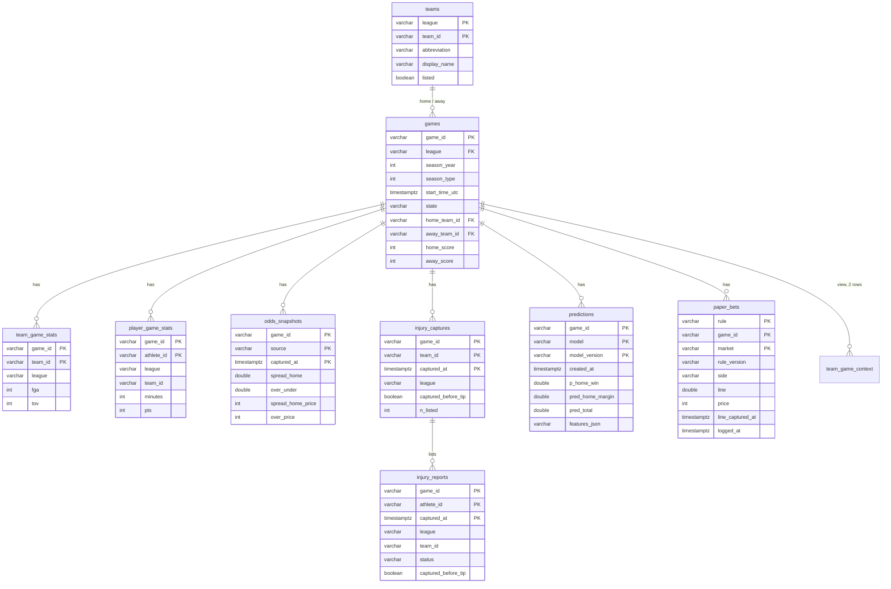

# Data model

Warehouse: `data/deepsports.duckdb`. The schema is defined in `src/deepsports/store.py`;
keep this doc in sync with it. All ids are ESPN ids stored as strings. All timestamps are `TIMESTAMPTZ` (UTC).

**Leagues:** `league` is `nba` or `ncaab` (NCAA men's D1). ESPN **team ids are only unique within a
league** (NBA 5 = Cleveland, NCAA 5 = UAB), so a team is identified by `(league, team_id)` and every
join to `teams` must match both. ESPN **event ids are unique across leagues**, so `game_id` alone
keys games and everything that hangs off a game.



## Tables

### `teams`
PK (`league`, `team_id`). `abbreviation` (e.g. `GS`, `NY`, `SA`, `NEV`: ESPN style, unique within a
league), `display_name`, `location`, `name`, `listed`, `updated_at`.
- `listed = true`: from the league's team list (`/teams`): the 30 NBA franchises, the 362 D1 schools.
- `listed = false`: seen only as an opponent on a college scoreboard (non-D1 schools). Written with
  insert-or-ignore, so a listed row is never downgraded. NBA scoreboards don't add teams, so
  All-Star/exhibition teams stay absent as before.

### `games`
One row per game, updated in place as it goes scheduled → in progress → final.
| Column | Notes |
|---|---|
| `game_id` | PK (unique across leagues) |
| `league` | `nba` / `ncaab` |
| `season_year` | Year the season ends: 2027 = 2026-27 |
| `season_type` | 1 preseason, 2 regular, 3 postseason, 5 play-in |
| `start_time_utc` | Scheduled tip-off |
| `status` / `state` / `completed` | e.g. `STATUS_FINAL` / `post` / true. Postponed games are `post` but not `completed` |
| `home_team_id`, `away_team_id` | → `teams` (`league`, `team_id`) |
| `home_score`, `away_score` | NULL until the game starts |
| `venue`, `venue_city`, `neutral_site`, `attendance`, `broadcasts` | `broadcasts` is a comma-separated list of every TV/stream listing (national and regional). Neutral sites are common in college (ESPN's home/away is nominal there) |

### `team_game_stats`
PK (`game_id`, `team_id`). `league` (the game's league; join `teams` on `league` + `team_id`), `home_away`, `fgm/fga`, `fg3m/fg3a`, `ftm/fta`, `oreb/dreb/reb`,
`ast`, `stl`, `blk`, `tov` (total including team turnovers), `pf`, `points_off_turnovers`,
`fast_break_points`, `points_in_paint`, `largest_lead`. Points come from `games` scores.

### `player_game_stats`
PK (`game_id`, `athlete_id`). `league`, `team_id`, `athlete_name`, `starter`, `did_not_play`,
`dnp_reason`, `ejected`, `minutes`, `pts`, shooting splits, rebounds, `ast`, `stl`, `blk`,
`tov`, `pf`, `plus_minus`. Stat columns are NULL for DNPs.

### `odds_snapshots`
PK (`game_id`, `source`, `captured_at`).
- `source = 'pregame'`: from the scoreboard, for games not yet started, written by `update`
  (08:00/14:00) and `odds-snapshot` (every 30 min for today + tomorrow, US/Eastern). A new row only
  when the line **or a price** moves (provider, spread, total, moneylines or any of the four
  spread/total prices differ from the game's latest row), so the rows form a line-movement history
  and `captured_at` is when we saw that line (the first row ~ when the line was first visible to us).
- `source = 'opening'`: from the ESPN core API (`odds-history --with-opening`) for final games.
  `captured_at` is the tip time, not when the line was posted (ESPN gives no posting time).
- `source = 'closing'`: from the game summary after it ends (or the core API when the summary has
  no `pickcenter`); one row per game. Core-API rows use the tip time as `captured_at`.
| Column | Notes |
|---|---|
| `provider`, `details` | e.g. `Draft Kings`, `DET -2.5` |
| `spread_home` | Home team's spread, negative = home favored |
| `over_under` | Total |
| `home_moneyline`, `away_moneyline` | American odds |
| `spread_home_price`, `spread_away_price` | American price of each side of the spread (e.g. -111 / -109). Since 2026-11-06 |
| `over_price`, `under_price` | American price of the over / under. Since 2026-11-06 |
Prices are NULL whenever the source omits them; anything that isn't a valid American price
(|x| < 100) is stored as NULL. `opening`/`closing` rows written before 2026-11-06 were filled
offline from the raw cache by `deepsports prices-backfill` (no refetch): each row takes the prices of
the response it was parsed from (core API for opening rows and closing rows stamped with the tip
time, the summary `pickcenter` for other closing rows), and only when that response's provider,
spread, total and moneylines equal the stored row. `pregame` rows from before 2026-11-06 keep NULL
prices (their scoreboard responses were overwritten by later fetches).

### `injury_captures` and `injury_reports`
ESPN's summary `injuries` list is the team's injury report **at fetch time**, not at game time
(see DATA_SOURCES.md). So each fetch is stored as a timestamped snapshot, and only
`captured_before_tip = true` rows are usable as model inputs.
- Both tables carry `league` (the game's league). College summaries have no injury list, so
  college snapshots currently produce no rows.
- `injury_captures`: PK (`game_id`, `team_id`, `captured_at`); one row per team per snapshot,
  written even when the list is empty (`n_listed = 0`), so "no injuries" differs from "not captured".
- `injury_reports`: PK (`game_id`, `athlete_id`, `captured_at`). `team_id`, `athlete_name`,
  `status` (`Out` / `Day-To-Day`), `injury_type` (body part or reason: `Ankle`, `Rest`, `Illness`),
  `detail` (`Sprain`), `side`, `return_date` (ESPN's estimate), `reported_at` (when ESPN last
  updated the status), `captured_at`, `captured_before_tip`.
- Writers: `pipeline.collect_injury_snapshots` (in `update`: pre-tip, from fresh summaries of games in
  the next 2 days) and `deepsports pretip` (NBA games tipping in 5-100 min, every 30 min); both fetch
  through `pipeline.fetch_injury_snapshots`, raw kept at `raw/espn/<league>/summary_pregame/<game>/<UTC timestamp>.json.gz`) and
  `pipeline.backfill_injuries_from_raw` (offline; completed-game summaries are stored with
  `captured_before_tip = false` and `captured_at` = the raw file's mtime). Re-adding a snapshot
  with the same `captured_at` replaces it.

### `predictions`
PK (`game_id`, `model`, `model_version`). `created_at`, `p_home_win`, `pred_home_margin`,
`pred_total`, `features_json` (the inputs used, as JSON). Write with `Store.add_predictions(rows)`
(upsert; a dict `features_json` is serialized, `created_at` defaults to now);
read with `Store.latest_predictions(game_ids, include_early=, exclude_versions=)` (newest per game and
model; the calendar leaves out `*-early` and `config.HIDDEN_MODEL_VERSIONS`).
Model versions in use: `model = 'v1'` with `model_version` `v1.0` / `v1.1` / `v1.1i` (NBA; v1.1i =
v1.1 + pre-tip injury reports, only for games with a captured report, rewritten by `deepsports pretip`
shortly before tip) and `ncaab-v1`
(college v1, `analysis/ncaab.py`; only D1-vs-D1 games where both teams have >= 5 completed games
this season). `ncaab-v1p` is the college prior model (`analysis/ncaab_prior.py`, frozen
`models/ncaab_prior/config.json`) on the same gate: graded, never displayed (`HIDDEN_MODEL_VERSIONS`).
`ncaab-v1-early` covers D1 games where each team has >= 1 game (opt-in in the web app; never on the
calendar); since 2026-11-06 09:00 UTC it comes from the prior model (before: college v1).
Written daily by `deepsports predict` (docs/PIPELINE.md). **No history:** each run overwrites the
row for a (game, model, version) with a fresh `created_at`, and only games that haven't tipped off
are ever written, so the stored row is the latest pre-tip prediction. A new model version gets its
own rows.

### `paper_bets`
Forward paper-trade log (watch-only, no money; `analysis/paper.py`, docs/DECISIONS.md
2026-11-04). PK (`rule`, `game_id`, `market`). **Insert-only:** `Store.add_paper_bets(rows)` does
`INSERT OR IGNORE`, so the first logged bet for a key is frozen and never updated (within one
batch the first row wins); it returns the number of new rows. Written by `deepsports paper log`
only for games that haven't started, from a line captured at or before `logged_at`.
| Column | Notes |
|---|---|
| `rule`, `rule_version` | Frozen rule name and definition version (`paper.RULES`) |
| `game_id`, `league` | |
| `market`, `side` | `spread` (home/away), `total` (over/under) or `moneyline` (home/away) |
| `line` | The line bet (spread_home convention for spreads; NULL for moneyline) |
| `price`, `stake` | American odds (-110 for spread/total) and units (1) |
| `model_value` | The rule's signal: `pred_total`, or the combined load minutes |
| `line_source`, `line_provider`, `line_captured_at` | The `odds_snapshots` row used (`pregame`, latest captured at or before logging) |
| `logged_at`, `start_time_utc` | When the bet was logged; the scheduled tip at that time |
| `inputs_json` | What the decision used (prediction version and `created_at`, edge, home/away loads, line details) |

### `venue_cities`
Static, seeded from `src/deepsports/venues.py` on every writer open: `city` (PK, matches
`games.venue_city`), `lat`, `lon`. The 30 home cities plus Inglewood, Austin, Las Vegas,
Mexico City, Paris, Berlin, London.

### `ingest_runs`
One row per collection command: `started_at`, `finished_at`, `command`,
`network_requests`, `games_upserted`, `boxscores_upserted`, `errors`, `notes`.

## Views

### `pregame_injuries`
`injury_reports` rows from the latest pre-tip capture per game and team.

### `team_game_context`
One row per team per game for season types 2, 3, 5, excluding postponed/canceled games and
games involving a team missing from `teams` (NBA All-Star, exhibitions). Windows are per
(`league`, `team_id`, season). Rows are emitted only for **listed** teams: a D1 school's game against
a non-D1 opponent counts toward its rest days, but the non-D1 side gets no row. Every value uses
only the team's **earlier games in the same season**, so it's leak-free for both past and upcoming games.
| Column | Notes |
|---|---|
| `game_id`, `team_id`, `opponent_id`, `is_home`, `start_time_utc`, `season_year`, `season_type` | |
| `league` | Last column; join `teams` on (`league`, `team_id`) |
| `rest_days` | US/Eastern calendar days since the previous game, capped at 7; NULL for the season's first game |
| `back_to_back` | `rest_days = 1` (false for the first game) |
| `games_last_7_days` | Team games on the 7 calendar days before this game's date (this game excluded) |
| `road_trip_length` | Consecutive away games including this one; 0 at home. Uses ESPN's home/away designation, also at neutral sites |
| `travel_km` | Great-circle km from the previous game's venue city; NULL for the first game or an unknown city (most college cities) |

Note: the view also counts the NBA Cup final, so a few team-seasons have 83 regular-season rows.

### `prediction_results`
Grading: one row per final game and (`model`, `model_version`), using the latest prediction with
`created_at < start_time_utc`. Never graded: predictions made at or after tip, games that aren't
`completed AND status = 'STATUS_FINAL'` with both scores (postponed, canceled), and games involving
a team not **listed** in that league (All-Star, exhibitions). The query is `store.PREDICTION_RESULTS_SQL`
(usable inline on a read-only connection to an older warehouse without the view).
| Column | Notes |
|---|---|
| `game_id`, `league`, `model`, `model_version`, `created_at`, `start_time_utc`, `home_abbr`, `away_abbr` | |
| `p_home_win`, `pred_home_margin`, `pred_total` | The prediction |
| `home_score`, `away_score`, `actual_home_margin`, `actual_total` | The result |
| `winner_correct` | `(p_home_win >= 0.5) = (home won)` |
| `margin_error`, `total_error` | Absolute errors in points |
| `market_spread_home`, `market_total` | Latest `closing` row, with per-league sanity limits (`store.SANE_LIMITS`, also used by `analysis.market`): NBA spreads with \|x\| > 40 and totals outside 150-320 become NULL; college \|x\| > 60 and totals outside 100-220 |
| `market_p_home` | De-vigged closing moneyline home win probability; NULL if either moneyline is missing |

`deepsports.analysis.record.prediction_record(con, league, days)` summarizes it for `/api/predictions/record`:
always one league and one model version (NBA and college are never mixed).

### `paper_results`
Grading of `paper_bets`: one row per logged bet on a game that is `completed AND status =
'STATUS_FINAL'` with both scores. Never graded: bets with `logged_at >= start_time_utc` (e.g. the
game was moved earlier) or a line captured after logging. The query is
`store.PAPER_RESULTS_SQL`. Columns: every `paper_bets` column, plus `season_year`, `season_type`,
`home_score`, `away_score`, `actual_home_margin`, `actual_total`, `tip_date` (US/Eastern),
`home_abbr`, `away_abbr`, the latest closing row (`close_spread_home`, `close_total` with the same
sanity limits as `prediction_results`, `close_home_ml`, `close_away_ml`), `result`
(`win`/`loss`/`push`; pushes refund), `profit` (units at `price`), and `clv` (points vs the
closing line, positive = the close moved toward the bet; spread/total only, NULL for moneyline).
`deepsports.analysis.paper.paper_report(con)` regrades the rows with `analysis.betting` for the
per-rule record, ROI with a day-clustered bootstrap CI, drawdown and CLV
(`deepsports paper report`).

## Migrations
`Store` compares every existing table's columns and primary key with `TABLES` in store.py. When
they differ (a warehouse written by older code), the first **writer** open rebuilds those tables
(`deepsports migrate` does just this and prints the row counts): in one transaction, each stale
table is copied into a new table with the current definition, the old one dropped, and the copy
renamed; views are recreated. New `league` columns are filled from the row's game (`'nba'` for
all legacy rows); `teams.listed` defaults to true. Row counts are checked per table and any
mismatch rolls everything back. Running it again is a no-op. Read-only opens never migrate, and
`status`, `check`, and `upcoming` work on both the old and new layout.

| Date | Change |
|---|---|
| 2026-11-06 | `odds_snapshots` gains nullable `spread_home_price`, `spread_away_price`, `over_price`, `under_price` (rebuild on the next writer open; existing rows start with NULL prices; `opening`/`closing` history filled by `deepsports prices-backfill`, no schema change) |
| 2026-11-04 | New `paper_bets` table and `paper_results` view (created on the next writer open; no rebuild) |
| 2026-11 | League-scoped team keys: `teams` PK (`team_id`) → (`league`, `team_id`); `teams.listed`; `league` on `team_game_stats`, `player_game_stats`, `injury_captures`, `injury_reports`; `team_game_context` partitions by league and gains a `league` column |

## Example queries
```sql
-- Home team win % and average margin this season
SELECT avg((home_score > away_score)::int) AS home_win_pct,
       avg(home_score - away_score)        AS avg_home_margin
FROM games WHERE league = 'nba' AND season_year = 2027 AND season_type = 2 AND completed;

-- Nevada's results (always join teams on league + team_id)
SELECT g.start_time_utc, h.abbreviation, g.home_score, a.abbreviation, g.away_score
FROM games g
JOIN teams h ON h.league = g.league AND h.team_id = g.home_team_id
JOIN teams a ON a.league = g.league AND a.team_id = g.away_team_id
WHERE g.league = 'ncaab' AND '2440' IN (g.home_team_id, g.away_team_id) AND g.completed;

-- How often the closing-line favorite covered
SELECT avg(((g.home_score - g.away_score) + o.spread_home > 0)::int) AS home_cover_pct
FROM games g JOIN odds_snapshots o USING (game_id)
WHERE o.source = 'closing' AND g.completed;
```
