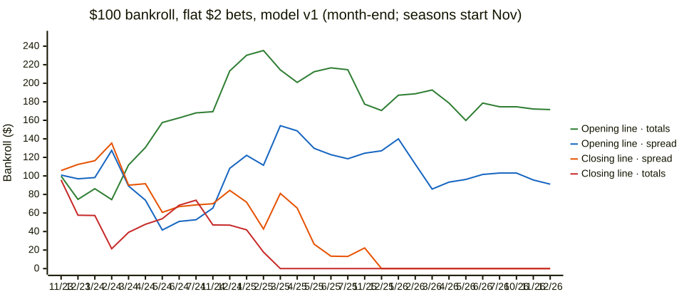

# What would $100 have done? Betting simulation of model v1



Source: `docs/diagrams/sim-v1-bankroll.mmd`, built from `/Volumes/ExFATStorag/DeepSports/reports/sim/v1.0/*-flatusd2.csv` (spread t=3, total t=4). The month-end values match the report's finals ($171.63 / $91.09 / $0 / $0).
Generated 2026-11-04 08:41 UTC. 4069 out-of-sample NBA games from 2023-10-24 to 2026-11-02 (seasons 2023-24 to 2026-27; ESPN season 2024 = 2023-24), 29 walk-forward folds (monthly refit). Fold check: OK.

**Not financial advice.** DeepSports is for following games and measuring a model honestly; placing bets is an explicit non-goal (docs/PRODUCT.md). This replays history on paper.
## Summary in plain language
- **Spreads at the closing line, flat $2 per bet** (bet when the model and the line differ by 3+ points): $100 -> $0.00 (1060 bets, hit 49.9%).
- The same at the **opening line**: $100 -> $91.09 (1404 bets, hit 52.2%).
- Moneyline at the closing line, edge 5%+, flat $2: $100 -> $0.00 (131 bets, hit 28.2%).
- Totals at the **opening line**, 4+ points, flat $2: $100 -> $171.63 (1883 bets, hit 53.4%). Between the opening and the close, the line moved toward the model's side more often than away (spread 47% vs 32%, total 59% vs 30%), so the model may hold a little real information against early lines. That edge is gone by the closing line, and opening lines are rarely available for meaningful stakes.
- Of 30 model strategies (flat $2, every market, threshold and line timing), 4 ended above $100; 0 of the spread/total ones have a hit rate whose whole 95% range is above the 52.4% break-even. Every one is in the tables below.

How to read this, if you are new to betting:
- **-110** is the usual price of a spread or over/under bet: you risk $110 to win $100 (or $2 to win about $1.82). If you win you get your stake back plus the win.
- So you must win **52.4%** of those bets just to break even (110 / 210), not 50%. The gap is the bookmaker's cut (the "vig").
- **Spread**: a handicap. Home -6.5 means the home team must win by 7+ for a home bet to win. **Total**: bet whether both teams together score over or under a number. **Moneyline**: bet a team just to win; favorites pay less than they risk (e.g. -200: risk $200 to win $100), underdogs more (+170: risk $100 to win $170).
- **Push**: the result lands exactly on the line; the stake is refunded.
- **Drawdown**: the biggest fall from a high point to a later low, as a share of the high point. A 40% drawdown means at some point you had lost 40% of your best balance.
- **ROI**: profit divided by the total amount staked. -4.5% is what a coin flip loses at -110 on average.
- **Hit rate 95% range**: with a few hundred bets, luck alone moves the hit rate by several points; only a range entirely above 52.4% suggests real skill.
- **Closing line** = the price right before tip-off, after all the news and the professionals' money: the hardest test. **Opening line** = the first price posted; easier to beat in principle, but see the caveats.
## Main strategies vs baselines (headline thresholds fixed in advance)
Headline thresholds were set before running: spread 3 pts, total 4 pts, moneyline edge 5%. Coin flip = same games, random side, mean of 500 seeded runs (5th-95th pct).
### Closing line
| strategy | sizing | bets | W-L-P | hit | 95% CI | staked | final | ROI | max DD | worst streak | end 2024 | end 2025 | end 2026 | end 2027 |
|---|---|---|---|---|---|---|---|---|---|---|---|---|---|---|
| spread: model, t >= 3 | flat $2 | 1060 of 1576 | 523-526-11 | 49.9% | 46.8%-52.9% | $2,116.82 | $0.00 (bust) | -4.7% | 100% | 12 | $68.72 | $13.09 | $0.00 | - |
| spread: coin flip, same games | flat $2 | 1576 | - | - | - | - | $10.95 ($0.00-$81.81) | -6.1% | - | - | - | - | - | - |
| spread: model, t >= 3 | 2% of bankroll | 1576 | 783-782-11 | 50.0% | 47.6%-52.5% | $1,863.93 | $18.51 | -4.4% | 89% | 12 | $65.93 | $34.89 | $22.00 | $18.51 |
| spread: coin flip, same games | 2% of bankroll | 1576 | - | - | - | - | $23.64 ($5.80-$63.50) | -5.4% | - | - | - | - | - | - |
| spread: always home | flat $2 | 892 of 4067 | 432-444-16 | 49.3% | 46.0%-52.6% | $1,775.44 | $0.00 (bust) | -5.6% | 100% | 8 | $0.00 | - | - | - |
| spread: always home | 2% of bankroll | 4067 | 2024-2025-18 | 50.0% | 48.4%-51.5% | $1,646.04 | $1.38 | -6.0% | 99% | 13 | $14.40 | $3.77 | $1.93 | $1.38 |
| total: model, t >= 4 | flat $2 | 988 of 1946 | 488-494-6 | 49.7% | 46.6%-52.8% | $1,973.87 | $0.00 (bust) | -5.1% | 100% | 11 | $73.81 | $0.00 | - | - |
| total: coin flip, same games | flat $2 | 1946 | - | - | - | - | $8.05 ($0.00-$65.10) | -6.2% | - | - | - | - | - | - |
| total: model, t >= 4 | 2% of bankroll | 1946 | 930-1010-6 | 47.9% | 45.7%-50.2% | $1,346.08 | $2.75 | -7.2% | 97% | 11 | $69.37 | $15.64 | $2.93 | $2.75 |
| total: coin flip, same games | 2% of bankroll | 1946 | - | - | - | - | $18.46 ($3.30-$49.52) | -5.3% | - | - | - | - | - | - |
| total: always over | flat $2 | 858 of 4067 | 416-428-14 | 49.3% | 45.9%-52.7% | $1,711.27 | $0.00 (bust) | -5.8% | 100% | 9 | $0.00 | - | - | - |
| total: always over | 2% of bankroll | 4067 | 2041-2011-15 | 50.4% | 48.8%-51.9% | $2,433.45 | $2.23 | -4.0% | 98% | 14 | $18.16 | $15.74 | $3.08 | $2.23 |
| moneyline: model, edge >= 5% | flat $2 | 131 of 2222 | 37-94-0 | 28.2% | 21.2%-36.5% | $258.06 | $0.00 (bust) | -38.7% | 100% | 17 | $0.00 | - | - | - |
| moneyline: coin flip, same games | flat $2 | 2222 | - | - | - | - | $3.15 ($0.00-$9.19) | -7.4% | - | - | - | - | - | - |
| moneyline: model, edge >= 5% | 2% of bankroll | 2222 | 790-1432-0 | 35.6% | 33.6%-37.6% | $593.75 | $0.69 | -16.7% | 99% | 19 | $9.37 | $4.70 | $0.95 | $0.69 |
| moneyline: coin flip, same games | 2% of bankroll | 2222 | - | - | - | - | $8.66 ($1.29-$26.84) | -6.1% | - | - | - | - | - | - |
| moneyline: model, edge >= 5% | 1/4 Kelly (cap 5%) | 1328 of 2222 | 476-852-0 | 35.8% | 33.3%-38.5% | $467.40 | $0.19 | -21.4% | 100% | 17 | $0.99 | $0.20 | $0.19 | - |
| moneyline: always favorite | flat $2 | 1755 of 4037 | 1208-547-0 | 68.8% | 66.6%-71.0% | $3,462.44 | $0.00 (bust) | -2.9% | 100% | 5 | $36.31 | $0.00 | - | - |
| moneyline: always favorite | 2% of bankroll | 4037 | 2786-1251-0 | 69.0% | 67.6%-70.4% | $3,172.56 | $3.76 | -3.0% | 97% | 8 | $46.10 | $14.36 | $3.74 | $3.76 |
| moneyline: always home | flat $2 | 762 of 4063 | 430-332-0 | 56.4% | 52.9%-59.9% | $1,515.71 | $0.00 (bust) | -6.6% | 100% | 6 | $0.00 | - | - | - |
| moneyline: always home | 2% of bankroll | 3530 of 4063 | 1920-1610-0 | 54.4% | 52.7%-56.0% | $1,298.21 | $0.48 | -7.7% | 100% | 9 | $8.93 | $1.16 | $0.48 | - |
### Opening line
| strategy | sizing | bets | W-L-P | hit | 95% CI | staked | final | ROI | max DD | worst streak | end 2024 | end 2025 | end 2026 | end 2027 |
|---|---|---|---|---|---|---|---|---|---|---|---|---|---|---|
| spread: model, t >= 3 | flat $2 | 1404 | 731-669-4 | 52.2% | 49.6%-54.8% | $2,808.00 | $91.09 | -0.3% | 73% | 11 | $52.72 | $118.54 | $103.09 | $91.09 |
| spread: coin flip, same games | flat $2 | 1404 | - | - | - | - | $15.44 ($0.00-$91.09) | -6.1% | - | - | - | - | - | - |
| spread: model, t >= 3 | 2% of bankroll | 1404 | 731-669-4 | 52.2% | 49.6%-54.8% | $2,754.12 | $70.91 | -1.1% | 63% | 11 | $57.65 | $102.50 | $80.60 | $70.91 |
| spread: coin flip, same games | 2% of bankroll | 1404 | - | - | - | - | $28.62 ($6.92-$70.32) | -5.4% | - | - | - | - | - | - |
| spread: always home | flat $2 | 833 of 3975 | 402-414-17 | 49.3% | 45.8%-52.7% | $1,656.25 | $0.00 (bust) | -6.0% | 100% | 8 | $0.00 | - | - | - |
| spread: always home | 2% of bankroll | 3975 | 1959-1996-20 | 49.5% | 48.0%-51.1% | $1,706.79 | $0.90 | -5.8% | 99% | 10 | $14.84 | $4.01 | $1.22 | $0.90 |
| total: model, t >= 4 | flat $2 | 1883 | 1003-876-4 | 53.4% | 51.1%-55.6% | $3,766.00 | $171.63 | 1.9% | 51% | 12 | $168.00 | $214.54 | $174.54 | $171.63 |
| total: coin flip, same games | flat $2 | 1883 | - | - | - | - | $5.71 ($0.00-$45.82) | -6.4% | - | - | - | - | - | - |
| total: model, t >= 4 | 2% of bankroll | 1883 | 1003-876-4 | 53.4% | 51.1%-55.6% | $6,668.69 | $141.76 | 0.6% | 67% | 12 | $176.21 | $245.06 | $146.64 | $141.76 |
| total: coin flip, same games | 2% of bankroll | 1883 | - | - | - | - | $17.22 ($3.24-$43.08) | -5.6% | - | - | - | - | - | - |
| total: always over | flat $2 | 849 of 4066 | 415-428-6 | 49.2% | 45.9%-52.6% | $1,696.54 | $0.00 (bust) | -5.9% | 100% | 9 | $0.00 | - | - | - |
| total: always over | 2% of bankroll | 4066 | 2042-2015-9 | 50.3% | 48.8%-51.9% | $2,202.82 | $1.99 | -4.4% | 99% | 14 | $14.21 | $9.49 | $2.71 | $1.99 |
| moneyline: model, edge >= 5% | flat $2 | 2142 | 882-1260-0 | 41.2% | 39.1%-43.3% | $4,284.00 | $30.07 | -1.6% | 86% | 11 | $39.51 | $118.20 | $60.39 | $30.07 |
| moneyline: coin flip, same games | flat $2 | 2142 | - | - | - | - | $14.82 ($0.00-$101.82) | -6.3% | - | - | - | - | - | - |
| moneyline: model, edge >= 5% | 2% of bankroll | 2142 | 882-1260-0 | 41.2% | 39.1%-43.3% | $2,847.94 | $19.03 | -2.8% | 85% | 11 | $41.22 | $62.25 | $26.12 | $19.03 |
| moneyline: coin flip, same games | 2% of bankroll | 2142 | - | - | - | - | $18.32 ($2.50-$55.60) | -4.8% | - | - | - | - | - | - |
| moneyline: model, edge >= 5% | 1/4 Kelly (cap 5%) | 2141 of 2142 | 881-1260-0 | 41.1% | 39.1%-43.2% | $2,444.56 | $2.25 | -4.0% | 99% | 11 | $14.06 | $11.59 | $4.00 | $2.25 |
| moneyline: always favorite | flat $2 | 1680 of 3911 | 1137-543-0 | 67.7% | 65.4%-69.9% | $3,321.49 | $0.00 (bust) | -3.0% | 100% | 5 | $73.33 | $0.00 | - | - |
| moneyline: always favorite | 2% of bankroll | 3911 | 2669-1242-0 | 68.2% | 66.8%-69.7% | $3,224.06 | $4.96 | -2.9% | 96% | 9 | $66.75 | $19.53 | $5.08 | $4.96 |
| moneyline: always home | flat $2 | 779 of 3976 | 433-346-0 | 55.6% | 52.1%-59.0% | $1,548.67 | $0.00 (bust) | -6.5% | 100% | 6 | $0.00 | - | - | - |
| moneyline: always home | 2% of bankroll | 3417 of 3976 | 1858-1559-0 | 54.4% | 52.7%-56.0% | $1,371.32 | $0.48 | -7.3% | 100% | 9 | $10.56 | $1.02 | $0.48 | - |
## Bootstrap: how much of the result is luck? (flat sizing)
Each strategy's bets resampled with replacement 2000 times and replayed. The range shows how differently the same hit rate could have played out; it is centered on what happened, so it does not prove or disprove skill.
| line | market | strategy | sizing | bets | actual final | boot median | 5th-95th pct | P(> $100) | P(bust) |
|---|---|---|---|---|---|---|---|---|---|
| closing | spread | model, t >= 0 | flat $2 | 835 | $0.00 | $0.00 | $0.00 - $0.00 | 0% | 100% |
| closing | spread | model, t >= 0 | 2% of bankroll | 3437 | $0.47 | $0.49 | $0.49 - $0.94 | 0% | 0% |
| closing | spread | model, t >= 1 | flat $2 | 725 | $0.00 | $0.00 | $0.00 - $0.00 | 0% | 100% |
| closing | spread | model, t >= 1 | 2% of bankroll | 3123 | $1.26 | $1.32 | $0.49 - $6.16 | 0% | 0% |
| closing | spread | model, t >= 2 | flat $2 | 1027 | $0.00 | $0.00 | $0.00 - $0.02 | 1% | 95% |
| closing | spread | model, t >= 2 | 2% of bankroll | 2265 | $7.48 | $7.54 | $1.80 - $33.43 | 0% | 0% |
| closing | spread | model, t >= 3 | flat $2 | 1060 | $0.00 | $0.00 | $0.00 - $87.45 | 3% | 81% |
| closing | spread | model, t >= 3 | 2% of bankroll | 1576 | $18.51 | $18.64 | $5.57 - $66.32 | 2% | 0% |
| closing | spread | model, t >= 5 | flat $2 | 629 | $50.72 | $49.00 | $0.00 - $128.91 | 15% | 22% |
| closing | spread | model, t >= 5 | 2% of bankroll | 629 | $54.94 | $53.76 | $25.55 - $119.26 | 11% | 0% |
| closing | total | model, t >= 0 | flat $2 | 1822 | $0.00 | $0.00 | $0.00 - $0.00 | 0% | 100% |
| closing | total | model, t >= 0 | 2% of bankroll | 4067 | $1.36 | $1.33 | $0.49 - $8.33 | 0% | 0% |
| closing | total | model, t >= 2 | flat $2 | 1397 | $0.00 | $0.00 | $0.00 - $0.00 | 0% | 100% |
| closing | total | model, t >= 2 | 2% of bankroll | 2952 | $1.82 | $1.83 | $0.49 - $8.81 | 0% | 0% |
| closing | total | model, t >= 4 | flat $2 | 988 | $0.00 | $0.00 | $0.00 - $0.00 | 0% | 100% |
| closing | total | model, t >= 4 | 2% of bankroll | 1946 | $2.75 | $2.73 | $0.92 - $10.02 | 0% | 0% |
| closing | total | model, t >= 6 | flat $2 | 847 | $0.00 | $0.00 | $0.00 - $48.00 | 1% | 87% |
| closing | total | model, t >= 6 | 2% of bankroll | 1141 | $17.02 | $17.03 | $6.15 - $49.43 | 0% | 0% |
| closing | total | model, t >= 10 | flat $2 | 279 | $46.00 | $46.00 | $0.00 - $99.45 | 5% | 10% |
| closing | total | model, t >= 10 | 2% of bankroll | 279 | $55.48 | $55.45 | $32.58 - $94.57 | 4% | 0% |
| closing | moneyline | model, edge >= 0% | flat $2 | 184 | $0.00 | $0.00 | $0.00 - $0.00 | 0% | 100% |
| closing | moneyline | model, edge >= 0% | 2% of bankroll | 2796 | $0.49 | $0.49 | $0.49 - $0.49 | 0% | 0% |
| closing | moneyline | model, edge >= 2% | flat $2 | 188 | $0.00 | $0.00 | $0.00 - $0.00 | 0% | 100% |
| closing | moneyline | model, edge >= 2% | 2% of bankroll | 2689 | $0.44 | $0.49 | $0.49 - $0.49 | 0% | 0% |
| closing | moneyline | model, edge >= 5% | flat $2 | 131 | $0.00 | $0.00 | $0.00 - $0.00 | 0% | 100% |
| closing | moneyline | model, edge >= 5% | 2% of bankroll | 2222 | $0.69 | $0.74 | $0.49 - $4.09 | 0% | 0% |
| closing | moneyline | model, edge >= 8% | flat $2 | 402 | $0.00 | $0.00 | $0.00 - $0.00 | 0% | 98% |
| closing | moneyline | model, edge >= 8% | 2% of bankroll | 1447 | $3.12 | $3.15 | $0.76 - $19.24 | 0% | 0% |
| closing | moneyline | model, edge >= 12% | flat $2 | 316 | $0.00 | $0.00 | $0.00 - $50.70 | 2% | 90% |
| closing | moneyline | model, edge >= 12% | 2% of bankroll | 770 | $12.50 | $12.49 | $3.93 - $46.27 | 0% | 0% |
| opening | spread | model, t >= 0 | flat $2 | 866 | $0.00 | $0.00 | $0.00 - $0.00 | 0% | 99% |
| opening | spread | model, t >= 0 | 2% of bankroll | 3975 | $1.44 | $1.57 | $0.49 - $9.49 | 0% | 0% |
| opening | spread | model, t >= 1 | flat $2 | 614 | $0.00 | $0.00 | $0.00 - $0.00 | 0% | 98% |
| opening | spread | model, t >= 1 | 2% of bankroll | 2973 | $3.67 | $3.84 | $0.89 - $21.42 | 0% | 0% |
| opening | spread | model, t >= 2 | flat $2 | 2112 | $23.30 | $0.00 | $0.00 - $157.81 | 16% | 60% |
| opening | spread | model, t >= 2 | 2% of bankroll | 2119 | $28.17 | $28.78 | $7.04 - $121.41 | 8% | 0% |
| opening | spread | model, t >= 3 | flat $2 | 1404 | $91.09 | $93.09 | $0.00 - $213.10 | 47% | 19% |
| opening | spread | model, t >= 3 | 2% of bankroll | 1404 | $70.91 | $72.47 | $22.19 - $239.91 | 33% | 0% |
| opening | spread | model, t >= 5 | flat $2 | 506 | $138.18 | $136.18 | $71.19 - $210.54 | 81% | 0% |
| opening | spread | model, t >= 5 | 2% of bankroll | 506 | $133.21 | $131.00 | $68.28 - $275.14 | 76% | 0% |
| opening | total | model, t >= 0 | flat $2 | 2762 | $0.00 | $0.00 | $0.00 - $101.65 | 5% | 87% |
| opening | total | model, t >= 0 | 2% of bankroll | 4066 | $7.25 | $7.83 | $1.25 - $54.42 | 1% | 0% |
| opening | total | model, t >= 2 | flat $2 | 2879 | $79.45 | $69.81 | $0.00 - $236.60 | 41% | 38% |
| opening | total | model, t >= 2 | 2% of bankroll | 2879 | $45.49 | $48.56 | $9.56 - $232.87 | 23% | 0% |
| opening | total | model, t >= 4 | flat $2 | 1883 | $171.63 | $171.54 | $0.00 - $303.27 | 79% | 6% |
| opening | total | model, t >= 4 | 2% of bankroll | 1883 | $141.76 | $145.20 | $37.68 - $542.31 | 67% | 0% |
| opening | total | model, t >= 6 | flat $2 | 1111 | $214.90 | $211.09 | $109.81 - $318.00 | 96% | 0% |
| opening | total | model, t >= 6 | 2% of bankroll | 1111 | $256.51 | $248.11 | $90.24 - $722.41 | 93% | 0% |
| opening | total | model, t >= 10 | flat $2 | 309 | $138.90 | $138.90 | $87.20 - $192.62 | 88% | 0% |
| opening | total | model, t >= 10 | 2% of bankroll | 309 | $139.12 | $139.50 | $83.15 - $238.80 | 85% | 0% |
| opening | moneyline | model, edge >= 0% | flat $2 | 829 | $0.00 | $0.00 | $0.00 - $0.00 | 2% | 96% |
| opening | moneyline | model, edge >= 0% | 2% of bankroll | 3976 | $0.99 | $1.14 | $0.49 - $15.01 | 0% | 0% |
| opening | moneyline | model, edge >= 2% | flat $2 | 654 | $0.00 | $0.00 | $0.00 - $0.00 | 2% | 96% |
| opening | moneyline | model, edge >= 2% | 2% of bankroll | 3176 | $1.77 | $1.91 | $0.49 - $18.65 | 0% | 0% |
| opening | moneyline | model, edge >= 5% | flat $2 | 2142 | $30.07 | $0.00 | $0.00 - $255.14 | 25% | 65% |
| opening | moneyline | model, edge >= 5% | 2% of bankroll | 2142 | $19.03 | $19.87 | $2.44 - $186.19 | 11% | 0% |
| opening | moneyline | model, edge >= 8% | flat $2 | 1307 | $34.80 | $0.00 | $0.00 - $207.18 | 25% | 55% |
| opening | moneyline | model, edge >= 8% | 2% of bankroll | 1307 | $30.23 | $31.69 | $6.26 - $168.56 | 13% | 0% |
| opening | moneyline | model, edge >= 12% | flat $2 | 590 | $77.71 | $74.88 | $0.00 - $191.27 | 36% | 22% |
| opening | moneyline | model, edge >= 12% | 2% of bankroll | 590 | $63.81 | $62.96 | $22.29 - $194.30 | 26% | 0% |
## Is Kelly justified? Calibration of v1 win probabilities
Kelly sizing bets more when the model is more confident, so it only helps if the model's probabilities are right. Bins of the model's home-win probability vs how often the home team actually won (all out-of-sample games):
| model p bin | games | model avg | home won | 95% CI | market avg |
|---|---|---|---|---|---|
| 0.0-0.1 | 12 | 7.1% | 16.7% | 4.7%-44.8% | 16.3% |
| 0.1-0.2 | 100 | 16.6% | 11.0% | 6.3%-18.6% | 15.9% |
| 0.2-0.3 | 261 | 25.4% | 19.9% | 15.5%-25.2% | 23.1% |
| 0.3-0.4 | 482 | 35.3% | 34.2% | 30.1%-38.6% | 33.7% |
| 0.4-0.5 | 616 | 45.2% | 43.5% | 39.6%-47.4% | 44.7% |
| 0.5-0.6 | 786 | 55.1% | 54.6% | 51.1%-58.0% | 54.6% |
| 0.6-0.7 | 746 | 64.7% | 61.9% | 58.4%-65.3% | 63.8% |
| 0.7-0.8 | 631 | 74.6% | 75.4% | 71.9%-78.6% | 74.3% |
| 0.8-0.9 | 368 | 83.8% | 81.8% | 77.5%-85.4% | 83.9% |
| 0.9-1.0 | 67 | 91.9% | 97.0% | 89.8%-99.2% | 89.2% |
The test that matters for Kelly: on the moneyline bets, the model's probability for the side it bet vs the market's vig-free probability vs what happened. If 'actual' tracks the market rather than the model, the model's edge is mostly imaginary and Kelly over-bets.
| line | strategy | bets | model p | market p | actual | 95% CI |
|---|---|---|---|---|---|---|
| closing | model, edge >= 0% | 4063 | 48.8% | 41.5% | 40.2% | 38.7%-41.7% |
| closing | model, edge >= 2% | 3261 | 48.3% | 39.6% | 37.4% | 35.7%-39.0% |
| closing | model, edge >= 5% | 2222 | 48.9% | 37.6% | 35.6% | 33.6%-37.6% |
| closing | model, edge >= 8% | 1447 | 49.7% | 35.9% | 34.7% | 32.3%-37.2% |
| closing | model, edge >= 12% | 770 | 52.2% | 34.8% | 33.0% | 29.8%-36.4% |
| opening | model, edge >= 0% | 3976 | 50.1% | 43.4% | 43.7% | 42.2%-45.3% |
| opening | model, edge >= 2% | 3176 | 50.3% | 42.1% | 42.1% | 40.4%-43.8% |
| opening | model, edge >= 5% | 2142 | 50.8% | 40.4% | 41.2% | 39.1%-43.3% |
| opening | model, edge >= 8% | 1307 | 52.2% | 39.1% | 39.8% | 37.2%-42.5% |
| opening | model, edge >= 12% | 590 | 54.4% | 37.2% | 39.0% | 35.1%-43.0% |
## Opening line: did the market later agree with the model?
If the model really knows something at the opening line, the line should tend to move toward the model's side by tip-off ("closing-line value"). Mean move in the bet's favor: points for spread/total, vig-free win probability for the moneyline.
| market | strategy | bets | mean move our way | moved toward us | moved against | hit |
|---|---|---|---|---|---|---|
| spread | model, t >= 0 | 3974 | +0.37 pts | 43% | 35% | 49.3% |
| spread | model, t >= 1 | 2972 | +0.49 pts | 44% | 34% | 48.0% |
| spread | model, t >= 2 | 2118 | +0.67 pts | 46% | 32% | 51.4% |
| spread | model, t >= 3 | 1404 | +0.80 pts | 47% | 32% | 52.2% |
| spread | model, t >= 5 | 506 | +1.55 pts | 52% | 30% | 54.4% |
| total | model, t >= 0 | 4064 | +0.89 pts | 53% | 37% | 51.4% |
| total | model, t >= 2 | 2877 | +1.26 pts | 56% | 34% | 52.2% |
| total | model, t >= 4 | 1882 | +1.69 pts | 59% | 30% | 53.4% |
| total | model, t >= 6 | 1110 | +2.24 pts | 63% | 28% | 55.1% |
| total | model, t >= 10 | 308 | +3.81 pts | 73% | 20% | 55.7% |
| moneyline | model, edge >= 0% | 3970 | +0.87 pp | 52% | 41% | 47.0% |
| moneyline | model, edge >= 2% | 3171 | +1.03 pp | 53% | 40% | 44.0% |
| moneyline | model, edge >= 5% | 2140 | +1.29 pp | 54% | 39% | 41.2% |
| moneyline | model, edge >= 8% | 1307 | +1.55 pp | 54% | 39% | 39.8% |
| moneyline | model, edge >= 12% | 590 | +2.04 pp | 54% | 38% | 39.0% |
### Leak check: drop games after a back-to-back
The model knows last night's results; an opening line posted before last night's games did not. Dropping every game where either team played the day before removes that path. If the opening-line edge were only this leak, it would vanish here. Headline thresholds, flat $2; 'ROI per unit' = profit per 1 staked on every bet, ignoring bankroll limits; hit rate is over every bet the rule picks (the bankroll run may have gone bust earlier).
| line | market | games | bets | hit | 95% CI | ROI per unit | final |
|---|---|---|---|---|---|---|---|
| closing | spread | all games | 1576 | 50.0% | 47.6%-52.5% | -4.5% | $0.00 |
| closing | spread | no back-to-backs | 1104 | 51.4% | 48.4%-54.3% | -1.9% | $57.63 |
| closing | total | all games | 1946 | 47.9% | 45.7%-50.2% | -8.5% | $0.00 |
| closing | total | no back-to-backs | 1427 | 48.7% | 46.1%-51.3% | -7.1% | $0.00 |
| closing | moneyline | all games | 2222 | 35.6% | 33.6%-37.6% | -10.3% | $0.00 |
| closing | moneyline | no back-to-backs | 1583 | 36.1% | 33.8%-38.5% | -9.0% | $0.00 |
| opening | spread | all games | 1404 | 52.2% | 49.6%-54.8% | -0.3% | $91.09 |
| opening | spread | no back-to-backs | 977 | 52.6% | 49.5%-55.7% | 0.5% | $108.90 |
| opening | total | all games | 1883 | 53.4% | 51.1%-55.6% | 1.9% | $171.63 |
| opening | total | no back-to-backs | 1341 | 53.8% | 51.2%-56.5% | 2.8% | $174.90 |
| opening | moneyline | all games | 2142 | 41.2% | 39.1%-43.3% | -1.6% | $30.07 |
| opening | moneyline | no back-to-backs | 1512 | 41.1% | 38.6%-43.6% | -2.6% | $24.51 |
## Every threshold (no cherry-picking)
All thresholds and sizings. The row marked **best (in-sample)** is the highest final bankroll in each block: picking it after seeing these results is cherry-picking (it is the luckiest of several tries), so it is not an estimate of future results.
### Closing line: spread
| strategy | sizing | bets | W-L-P | hit | 95% CI | staked | final | ROI | max DD | worst streak | end 2024 | end 2025 | end 2026 | end 2027 |
|---|---|---|---|---|---|---|---|---|---|---|---|---|---|---|
| model, t >= 0 | flat $2 | 835 of 4067 | 401-418-16 | 49.0% | 45.6%-52.4% | $1,658.31 | $0.00 (bust) | -6.0% | 100% | 8 | $0.00 | - | - | - |
| model, t >= 0 | 2% of bankroll | 3437 of 4067 | 1651-1768-18 | 48.3% | 46.6%-50.0% | $1,281.64 | $0.47 | -7.8% | 100% | 11 | $10.93 | $1.88 | $0.47 | - |
| model, t >= 1 | flat $2 | 725 of 3123 | 347-364-14 | 48.8% | 45.1%-52.5% | $1,445.36 | $0.00 (bust) | -6.9% | 100% | 11 | $0.00 | - | - | - |
| model, t >= 1 | 2% of bankroll | 3123 | 1524-1583-16 | 49.1% | 47.3%-50.8% | $1,417.85 | $1.26 | -7.0% | 99% | 11 | $16.91 | $6.54 | $1.71 | $1.26 |
| model, t >= 2 | flat $2 | 1027 of 2265 | 505-509-13 | 49.8% | 46.7%-52.9% | $2,052.08 | $0.00 (bust) | -4.9% | 100% | 16 | $46.54 | $0.00 | - | - |
| model, t >= 2 | 2% of bankroll | 2265 | 1122-1130-13 | 49.8% | 47.8%-51.9% | $2,048.92 | $7.48 | -4.5% | 94% | 16 | $49.95 | $21.79 | $9.95 | $7.48 |
| model, t >= 3 | flat $2 | 1060 of 1576 | 523-526-11 | 49.9% | 46.8%-52.9% | $2,116.82 | $0.00 (bust) | -4.7% | 100% | 12 | $68.72 | $13.09 | $0.00 | - |
| model, t >= 3 | 2% of bankroll | 1576 | 783-782-11 | 50.0% | 47.6%-52.5% | $1,863.93 | $18.51 | -4.4% | 89% | 12 | $65.93 | $34.89 | $22.00 | $18.51 |
| model, t >= 5 | flat $2 | 629 | 315-311-3 | 50.3% | 46.4%-54.2% | $1,258.00 | $50.72 | -3.9% | 76% | 11 | $75.27 | $62.00 | $52.00 | $50.72 |
| model, t >= 5 **best (in-sample)** | 2% of bankroll | 629 | 315-311-3 | 50.3% | 46.4%-54.2% | $915.36 | $54.94 | -4.9% | 62% | 11 | $75.79 | $64.18 | $55.84 | $54.94 |
| always home | flat $2 | 892 of 4067 | 432-444-16 | 49.3% | 46.0%-52.6% | $1,775.44 | $0.00 (bust) | -5.6% | 100% | 8 | $0.00 | - | - | - |
| always home | 2% of bankroll | 4067 | 2024-2025-18 | 50.0% | 48.4%-51.5% | $1,646.04 | $1.38 | -6.0% | 99% | 13 | $14.40 | $3.77 | $1.93 | $1.38 |
### Closing line: total
| strategy | sizing | bets | W-L-P | hit | 95% CI | staked | final | ROI | max DD | worst streak | end 2024 | end 2025 | end 2026 | end 2027 |
|---|---|---|---|---|---|---|---|---|---|---|---|---|---|---|
| model, t >= 0 | flat $2 | 1822 of 4067 | 922-885-15 | 51.0% | 48.7%-53.3% | $3,623.46 | $0.00 (bust) | -2.8% | 100% | 13 | $68.75 | $0.00 | - | - |
| model, t >= 0 | 2% of bankroll | 4067 | 2024-2028-15 | 50.0% | 48.4%-51.5% | $2,214.89 | $1.36 | -4.5% | 99% | 14 | $58.71 | $7.58 | $1.32 | $1.36 |
| model, t >= 2 | flat $2 | 1397 of 2952 | 701-687-9 | 50.5% | 47.9%-53.1% | $2,787.19 | $0.00 (bust) | -3.6% | 100% | 10 | $68.90 | $0.00 | - | - |
| model, t >= 2 | 2% of bankroll | 2952 | 1448-1495-9 | 49.2% | 47.4%-51.0% | $1,734.31 | $1.82 | -5.7% | 98% | 13 | $61.39 | $11.87 | $1.88 | $1.82 |
| model, t >= 4 | flat $2 | 988 of 1946 | 488-494-6 | 49.7% | 46.6%-52.8% | $1,973.87 | $0.00 (bust) | -5.1% | 100% | 11 | $73.81 | $0.00 | - | - |
| model, t >= 4 | 2% of bankroll | 1946 | 930-1010-6 | 47.9% | 45.7%-50.2% | $1,346.08 | $2.75 | -7.2% | 97% | 11 | $69.37 | $15.64 | $2.93 | $2.75 |
| model, t >= 6 | flat $2 | 847 of 1141 | 416-428-3 | 49.3% | 45.9%-52.7% | $1,688.99 | $0.00 (bust) | -5.9% | 100% | 9 | $63.63 | $24.90 | $0.00 | - |
| model, t >= 6 | 2% of bankroll | 1141 | 555-583-3 | 48.8% | 45.9%-51.7% | $1,080.32 | $17.02 | -7.7% | 85% | 9 | $65.38 | $41.23 | $16.60 | $17.02 |
| model, t >= 10 | flat $2 | 279 | 132-147-0 | 47.3% | 41.5%-53.2% | $558.00 | $46.00 | -9.7% | 59% | 6 | $98.54 | $69.09 | $47.09 | $46.00 |
| model, t >= 10 **best (in-sample)** | 2% of bankroll | 279 | 132-147-0 | 47.3% | 41.5%-53.2% | $451.15 | $55.48 | -9.9% | 49% | 6 | $96.99 | $70.89 | $56.13 | $55.48 |
| always over | flat $2 | 858 of 4067 | 416-428-14 | 49.3% | 45.9%-52.7% | $1,711.27 | $0.00 (bust) | -5.8% | 100% | 9 | $0.00 | - | - | - |
| always over | 2% of bankroll | 4067 | 2041-2011-15 | 50.4% | 48.8%-51.9% | $2,433.45 | $2.23 | -4.0% | 98% | 14 | $18.16 | $15.74 | $3.08 | $2.23 |
### Closing line: moneyline
| strategy | sizing | bets | W-L-P | hit | 95% CI | staked | final | ROI | max DD | worst streak | end 2024 | end 2025 | end 2026 | end 2027 |
|---|---|---|---|---|---|---|---|---|---|---|---|---|---|---|
| model, edge >= 0% | flat $2 | 184 of 4063 | 66-118-0 | 35.9% | 29.3%-43.0% | $364.76 | $0.00 (bust) | -27.4% | 100% | 13 | $0.00 | - | - | - |
| model, edge >= 0% | 2% of bankroll | 2796 of 4063 | 1124-1672-0 | 40.2% | 38.4%-42.0% | $625.31 | $0.49 | -15.9% | 100% | 15 | $4.79 | $0.66 | $0.49 | - |
| model, edge >= 0% | 1/4 Kelly (cap 5%) | 1572 of 4063 | 556-1016-0 | 35.4% | 33.0%-37.8% | $487.81 | $0.19 | -20.5% | 100% | 14 | $0.83 | $0.19 | - | - |
| model, edge >= 2% | flat $2 | 188 of 3261 | 64-124-0 | 34.0% | 27.6%-41.1% | $371.70 | $0.00 (bust) | -26.9% | 100% | 12 | $0.00 | - | - | - |
| model, edge >= 2% | 2% of bankroll | 2689 of 3261 | 1027-1662-0 | 38.2% | 36.4%-40.0% | $555.35 | $0.44 | -17.9% | 100% | 14 | $4.84 | $0.98 | $0.44 | - |
| model, edge >= 2% | 1/4 Kelly (cap 5%) | 1557 of 3261 | 556-1001-0 | 35.7% | 33.4%-38.1% | $488.43 | $0.19 | -20.4% | 100% | 14 | $0.80 | $0.20 | $0.19 | - |
| model, edge >= 5% | flat $2 | 131 of 2222 | 37-94-0 | 28.2% | 21.2%-36.5% | $258.06 | $0.00 (bust) | -38.7% | 100% | 17 | $0.00 | - | - | - |
| model, edge >= 5% | 2% of bankroll | 2222 | 790-1432-0 | 35.6% | 33.6%-37.6% | $593.75 | $0.69 | -16.7% | 99% | 19 | $9.37 | $4.70 | $0.95 | $0.69 |
| model, edge >= 5% | 1/4 Kelly (cap 5%) | 1328 of 2222 | 476-852-0 | 35.8% | 33.3%-38.5% | $467.40 | $0.19 | -21.4% | 100% | 17 | $0.99 | $0.20 | $0.19 | - |
| model, edge >= 8% | flat $2 | 402 of 1447 | 136-266-0 | 33.8% | 29.4%-38.6% | $803.78 | $0.00 (bust) | -12.4% | 100% | 27 | $0.00 | - | - | - |
| model, edge >= 8% | 2% of bankroll | 1447 | 502-945-0 | 34.7% | 32.3%-37.2% | $780.92 | $3.12 | -12.4% | 97% | 27 | $23.52 | $9.68 | $4.32 | $3.12 |
| model, edge >= 8% | 1/4 Kelly (cap 5%) | 1294 of 1447 | 455-839-0 | 35.2% | 32.6%-37.8% | $686.63 | $0.19 | -14.5% | 100% | 27 | $3.19 | $0.47 | $0.19 | - |
| model, edge >= 12% | flat $2 | 316 of 770 | 99-217-0 | 31.3% | 26.5%-36.6% | $630.25 | $0.00 (bust) | -15.9% | 100% | 16 | $13.95 | $0.00 | - | - |
| model, edge >= 12% **best (in-sample)** | 2% of bankroll | 770 | 254-516-0 | 33.0% | 29.8%-36.4% | $627.70 | $12.50 | -13.9% | 88% | 16 | $38.27 | $26.84 | $15.06 | $12.50 |
| model, edge >= 12% | 1/4 Kelly (cap 5%) | 770 | 254-516-0 | 33.0% | 29.8%-36.4% | $578.56 | $0.51 | -17.2% | 100% | 16 | $8.26 | $2.66 | $0.76 | $0.51 |
| always favorite | flat $2 | 1755 of 4037 | 1208-547-0 | 68.8% | 66.6%-71.0% | $3,462.44 | $0.00 (bust) | -2.9% | 100% | 5 | $36.31 | $0.00 | - | - |
| always favorite | 2% of bankroll | 4037 | 2786-1251-0 | 69.0% | 67.6%-70.4% | $3,172.56 | $3.76 | -3.0% | 97% | 8 | $46.10 | $14.36 | $3.74 | $3.76 |
| always home | flat $2 | 762 of 4063 | 430-332-0 | 56.4% | 52.9%-59.9% | $1,515.71 | $0.00 (bust) | -6.6% | 100% | 6 | $0.00 | - | - | - |
| always home | 2% of bankroll | 3530 of 4063 | 1920-1610-0 | 54.4% | 52.7%-56.0% | $1,298.21 | $0.48 | -7.7% | 100% | 9 | $8.93 | $1.16 | $0.48 | - |
### Opening line: spread
| strategy | sizing | bets | W-L-P | hit | 95% CI | staked | final | ROI | max DD | worst streak | end 2024 | end 2025 | end 2026 | end 2027 |
|---|---|---|---|---|---|---|---|---|---|---|---|---|---|---|
| model, t >= 0 | flat $2 | 866 of 3975 | 418-430-18 | 49.3% | 45.9%-52.7% | $1,726.90 | $0.00 (bust) | -5.8% | 100% | 7 | $0.00 | - | - | - |
| model, t >= 0 | 2% of bankroll | 3975 | 1977-1978-20 | 50.0% | 48.4%-51.5% | $1,991.44 | $1.44 | -4.9% | 99% | 10 | $13.39 | $6.37 | $1.97 | $1.44 |
| model, t >= 1 | flat $2 | 614 of 2973 | 289-313-12 | 48.0% | 44.0%-52.0% | $1,227.45 | $0.00 (bust) | -8.1% | 100% | 10 | $0.00 | - | - | - |
| model, t >= 1 | 2% of bankroll | 2973 | 1478-1482-13 | 49.9% | 48.1%-51.7% | $1,758.20 | $3.67 | -5.5% | 97% | 10 | $18.37 | $13.10 | $5.32 | $3.67 |
| model, t >= 2 | flat $2 | 2112 of 2119 | 1082-1023-7 | 51.4% | 49.3%-53.5% | $4,220.92 | $23.30 | -1.8% | 97% | 12 | $22.18 | $43.09 | $40.57 | $23.30 |
| model, t >= 2 | 2% of bankroll | 2119 | 1084-1028-7 | 51.3% | 49.2%-53.5% | $2,318.82 | $28.17 | -3.1% | 78% | 12 | $37.15 | $40.30 | $34.03 | $28.17 |
| model, t >= 3 | flat $2 | 1404 | 731-669-4 | 52.2% | 49.6%-54.8% | $2,808.00 | $91.09 | -0.3% | 73% | 11 | $52.72 | $118.54 | $103.09 | $91.09 |
| model, t >= 3 | 2% of bankroll | 1404 | 731-669-4 | 52.2% | 49.6%-54.8% | $2,754.12 | $70.91 | -1.1% | 63% | 11 | $57.65 | $102.50 | $80.60 | $70.91 |
| model, t >= 5 **best (in-sample)** | flat $2 | 506 | 274-230-2 | 54.4% | 50.0%-58.7% | $1,012.00 | $138.18 | 3.8% | 36% | 7 | $94.54 | $148.54 | $132.36 | $138.18 |
| model, t >= 5 | 2% of bankroll | 506 | 274-230-2 | 54.4% | 50.0%-58.7% | $1,330.56 | $133.21 | 2.5% | 41% | 7 | $92.10 | $152.30 | $126.10 | $133.21 |
| always home | flat $2 | 833 of 3975 | 402-414-17 | 49.3% | 45.8%-52.7% | $1,656.25 | $0.00 (bust) | -6.0% | 100% | 8 | $0.00 | - | - | - |
| always home | 2% of bankroll | 3975 | 1959-1996-20 | 49.5% | 48.0%-51.1% | $1,706.79 | $0.90 | -5.8% | 99% | 10 | $14.84 | $4.01 | $1.22 | $0.90 |
### Opening line: total
| strategy | sizing | bets | W-L-P | hit | 95% CI | staked | final | ROI | max DD | worst streak | end 2024 | end 2025 | end 2026 | end 2027 |
|---|---|---|---|---|---|---|---|---|---|---|---|---|---|---|
| model, t >= 0 | flat $2 | 2762 of 4066 | 1415-1338-9 | 51.4% | 49.5%-53.3% | $5,518.64 | $0.00 (bust) | -1.8% | 100% | 11 | $75.09 | $71.45 | $0.00 | - |
| model, t >= 0 | 2% of bankroll | 4066 | 2077-1980-9 | 51.2% | 49.7%-52.7% | $3,552.25 | $7.25 | -2.6% | 94% | 11 | $56.80 | $40.83 | $6.84 | $7.25 |
| model, t >= 2 | flat $2 | 2879 | 1499-1373-7 | 52.2% | 50.4%-54.0% | $5,758.00 | $79.45 | -0.4% | 80% | 10 | $129.81 | $175.63 | $62.00 | $79.45 |
| model, t >= 2 | 2% of bankroll | 2879 | 1499-1373-7 | 52.2% | 50.4%-54.0% | $5,667.86 | $45.49 | -1.0% | 85% | 10 | $114.70 | $146.88 | $38.53 | $45.49 |
| model, t >= 4 | flat $2 | 1883 | 1003-876-4 | 53.4% | 51.1%-55.6% | $3,766.00 | $171.63 | 1.9% | 51% | 12 | $168.00 | $214.54 | $174.54 | $171.63 |
| model, t >= 4 | 2% of bankroll | 1883 | 1003-876-4 | 53.4% | 51.1%-55.6% | $6,668.69 | $141.76 | 0.6% | 67% | 12 | $176.21 | $245.06 | $146.64 | $141.76 |
| model, t >= 6 | flat $2 | 1111 | 611-498-2 | 55.1% | 52.2%-58.0% | $2,222.00 | $214.90 | 5.2% | 24% | 9 | $176.72 | $253.81 | $208.18 | $214.90 |
| model, t >= 6 **best (in-sample)** | 2% of bankroll | 1111 | 611-498-2 | 55.1% | 52.2%-58.0% | $5,518.46 | $256.51 | 2.8% | 50% | 9 | $201.94 | $401.40 | $240.85 | $256.51 |
| model, t >= 10 | flat $2 | 309 | 171-136-2 | 55.7% | 50.1%-61.2% | $618.00 | $138.90 | 6.3% | 16% | 7 | $111.81 | $147.63 | $143.63 | $138.90 |
| model, t >= 10 | 2% of bankroll | 309 | 171-136-2 | 55.7% | 50.1%-61.2% | $786.24 | $139.12 | 5.0% | 19% | 7 | $109.92 | $153.54 | $145.96 | $139.12 |
| always over | flat $2 | 849 of 4066 | 415-428-6 | 49.2% | 45.9%-52.6% | $1,696.54 | $0.00 (bust) | -5.9% | 100% | 9 | $0.00 | - | - | - |
| always over | 2% of bankroll | 4066 | 2042-2015-9 | 50.3% | 48.8%-51.9% | $2,202.82 | $1.99 | -4.4% | 99% | 14 | $14.21 | $9.49 | $2.71 | $1.99 |
### Opening line: moneyline
| strategy | sizing | bets | W-L-P | hit | 95% CI | staked | final | ROI | max DD | worst streak | end 2024 | end 2025 | end 2026 | end 2027 |
|---|---|---|---|---|---|---|---|---|---|---|---|---|---|---|
| model, edge >= 0% | flat $2 | 829 of 3976 | 390-439-0 | 47.0% | 43.7%-50.4% | $1,653.80 | $0.00 (bust) | -6.0% | 100% | 8 | $0.00 | - | - | - |
| model, edge >= 0% | 2% of bankroll | 3976 | 1738-2238-0 | 43.7% | 42.2%-45.3% | $1,878.71 | $0.99 | -5.3% | 99% | 12 | $19.24 | $7.53 | $1.56 | $0.99 |
| model, edge >= 0% | 1/4 Kelly (cap 5%) | 3061 of 3976 | 1220-1841-0 | 39.9% | 38.1%-41.6% | $2,045.58 | $1.02 | -4.8% | 99% | 11 | $10.01 | $5.63 | $1.87 | $1.02 |
| model, edge >= 2% | flat $2 | 654 of 3176 | 288-366-0 | 44.0% | 40.3%-47.9% | $1,302.15 | $0.00 (bust) | -7.7% | 100% | 8 | $0.00 | - | - | - |
| model, edge >= 2% | 2% of bankroll | 3176 | 1337-1839-0 | 42.1% | 40.4%-43.8% | $1,743.63 | $1.77 | -5.6% | 98% | 12 | $22.24 | $12.45 | $2.83 | $1.77 |
| model, edge >= 2% | 1/4 Kelly (cap 5%) | 2977 of 3176 | 1206-1771-0 | 40.5% | 38.8%-42.3% | $2,090.13 | $1.10 | -4.7% | 99% | 11 | $10.34 | $5.86 | $1.97 | $1.10 |
| model, edge >= 5% | flat $2 | 2142 | 882-1260-0 | 41.2% | 39.1%-43.3% | $4,284.00 | $30.07 | -1.6% | 86% | 11 | $39.51 | $118.20 | $60.39 | $30.07 |
| model, edge >= 5% | 2% of bankroll | 2142 | 882-1260-0 | 41.2% | 39.1%-43.3% | $2,847.94 | $19.03 | -2.8% | 85% | 11 | $41.22 | $62.25 | $26.12 | $19.03 |
| model, edge >= 5% | 1/4 Kelly (cap 5%) | 2141 of 2142 | 881-1260-0 | 41.1% | 39.1%-43.2% | $2,444.56 | $2.25 | -4.0% | 99% | 11 | $14.06 | $11.59 | $4.00 | $2.25 |
| model, edge >= 8% | flat $2 | 1307 | 520-787-0 | 39.8% | 37.2%-42.5% | $2,614.00 | $34.80 | -2.5% | 91% | 15 | $32.07 | $68.60 | $61.01 | $34.80 |
| model, edge >= 8% | 2% of bankroll | 1307 | 520-787-0 | 39.8% | 37.2%-42.5% | $1,701.01 | $30.23 | -4.1% | 78% | 15 | $43.15 | $49.85 | $39.71 | $30.23 |
| model, edge >= 8% | 1/4 Kelly (cap 5%) | 1306 of 1307 | 519-787-0 | 39.7% | 37.1%-42.4% | $1,848.75 | $3.44 | -5.2% | 98% | 15 | $13.91 | $9.10 | $5.95 | $3.44 |
| model, edge >= 12% **best (in-sample)** | flat $2 | 590 | 230-360-0 | 39.0% | 35.1%-43.0% | $1,180.00 | $77.71 | -1.9% | 62% | 14 | $95.09 | $92.09 | $83.51 | $77.71 |
| model, edge >= 12% | 2% of bankroll | 590 | 230-360-0 | 39.0% | 35.1%-43.0% | $1,132.86 | $63.81 | -3.2% | 67% | 14 | $89.69 | $79.63 | $67.86 | $63.81 |
| model, edge >= 12% | 1/4 Kelly (cap 5%) | 589 of 590 | 229-360-0 | 38.9% | 35.0%-42.9% | $2,235.47 | $22.54 | -3.5% | 94% | 14 | $60.63 | $40.44 | $26.64 | $22.54 |
| always favorite | flat $2 | 1680 of 3911 | 1137-543-0 | 67.7% | 65.4%-69.9% | $3,321.49 | $0.00 (bust) | -3.0% | 100% | 5 | $73.33 | $0.00 | - | - |
| always favorite | 2% of bankroll | 3911 | 2669-1242-0 | 68.2% | 66.8%-69.7% | $3,224.06 | $4.96 | -2.9% | 96% | 9 | $66.75 | $19.53 | $5.08 | $4.96 |
| always home | flat $2 | 779 of 3976 | 433-346-0 | 55.6% | 52.1%-59.0% | $1,548.67 | $0.00 (bust) | -6.5% | 100% | 6 | $0.00 | - | - | - |
| always home | 2% of bankroll | 3417 of 3976 | 1858-1559-0 | 54.4% | 52.7%-56.0% | $1,371.32 | $0.48 | -7.3% | 100% | 9 | $10.56 | $1.02 | $0.48 | - |
## Method and assumptions
- Predictions: `backtest.walk_forward` with model v1, monthly refit, the same folds as the backtest report. Each month is predicted by a model trained only on games that tipped off before that month started. Features use only games finished 4+ hours before tip-off.
- Lines: latest `closing` row per game (4069 of 4069 games have one), earliest `opening` row (4067 games). Spreads with |x| > 40 and totals outside 150-320 are dropped. Providers: ESPN BET / DraftKings (as stored).
- Prices: the warehouse stores no spread or total prices, so every spread/total bet is at -110 (decimal 1.909). Moneylines use the stored American odds of the same row.
- Edges: spread edge = model home margin - (-spread_home); total edge = model total - line; moneyline edge = model home-win probability - `metrics.devig_probability`. An exact zero edge is no bet.
- Bankroll: game days are US Eastern dates. Every stake on a day comes from the start-of-day bankroll; a day's stakes never exceed it; results are applied when the day ends. Stakes are rounded down to cents; below $0.01 the run is over (bust).
- Sizing: flat $2 (2% of the start); 2% of bankroll at the start of the day; 1/4 Kelly on the model's moneyline probability, capped at 5% of the bankroll, no bet if Kelly is <= 0.
- Baselines use the same sizing: always the home team (spread, moneyline), always the favorite (moneyline), always the over (total), and a coin flip on the same games as each strategy.
- Losing streak: consecutive losses; pushes neither break nor extend it. Max drawdown uses end-of-day balances.
- Bootstrap: 2000 resamples of the strategy's bets (with replacement), played one at a time. Seeded, reproducible.
## Caveats (read before believing any number)
- **Selection bias.** Many strategies were tried (3 markets x 5 thresholds x 2-3 sizings x 2 line timings). Even with zero skill, some will look good. Only the pre-set headline thresholds are honest single estimates.
- **Real books limit stakes and move lines.** Winners get their limits cut; a line we 'bet' may not have been available in size, and prices other than -110 (e.g. -115) are common. Results here are an upper bound on what was achievable.
- **Opening lines are optimistic for the model.** The stored opening rows carry the tip-off time as their timestamp, not when they were posted. An opening line is usually posted the day before or the morning of the game, while the model's features include games that finished up to 4 hours before tip-off (e.g. the previous night's game of a team on a back-to-back). Some opening-line bets therefore used information the line did not yet have. Treat opening-line results as a best case.
- **Closing moneylines and providers.** Closing rows come from ESPN's game summary after the game; they are the book's last pre-game price, not a price we could always get. Opening and closing usually come from the same provider (a few dozen games differ).
- **Correlated bets.** Same-day bets are sized together; streaks matter, and the bootstrap's independence assumption understates bad-luck runs a little.
- **Past results do not predict future ones.** The market adapts; this model uses only public box-score data the market already prices in.
## Reproduce
```
uv run python -m deepsports.analysis.simulate --model-version v1.0 --bankroll 100 --out <report.md>
```
Bankroll-over-time CSVs (date, end-of-day bankroll), one per strategy: `/Volumes/ExFATStorag/DeepSports/reports/sim/v1.0`
