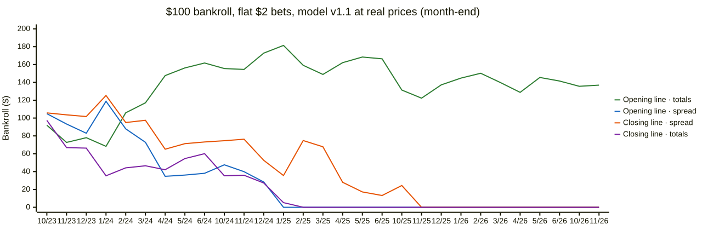

# $100 betting simulation, re-run: model v1.1 at real spread/total prices



Source: `docs/diagrams/sim-v1.1-prices-bankroll.mmd`, built from
`/Volumes/ExFATStorag/DeepSports/reports/sim/v1.1-real/*-flatusd2.csv` (spread t=3, total t=4). The month-end values
match the finals below ($136.89 / $0 / $0 / $0).

**Not financial advice.** DeepSports is for following games and measuring a model honestly. Placing bets is an
explicit non-goal (docs/PRODUCT.md). This replays history on paper.

## In plain language
- **What changed.** The first simulation (2026-11-04) paid every spread and over/under bet at **-110** (risk $110
  to win $100), because we didn't store real prices. Now the warehouse holds the price the book listed for each side,
  e.g. -115 on one side and -105 on the other. This run pays each bet at its real price. It also uses the newer
  model **v1.1** (v1 plus player-availability features).
- **At the closing line nothing changes. Every strategy still goes broke.** Spreads, totals and moneylines all
  end at $0 with flat $2 bets, with v1.0 or v1.1. Closing prices average almost exactly -110. On average the real
  prices cost **less than a quarter of a cent per $2 bet** compared with -110.
- **At the opening line the old best result shrinks.** v1's "opening totals" strategy turned $100 into $171.63 at
  -110. At real prices it ends at **$111.44** (v1.1: **$136.89**). The opening spread strategy drops from $91.09 to
  $29.90 (v1.1: $0, bust). The reason matters. When the model disagrees with an early line, the book has usually
  already **charged more for the side the model likes**: about -113 to -114 on average, and about -120 when the
  disagreement is 5+ points. Part of the "stale line" the model spotted was already priced into the juice.
- **No strategy shows real skill.** Across 30 model strategies per run, none has a hit rate whose 95% range is above
  its break-even. The best headline case (v1.1, opening totals) won 53.7% (95% range 51.5–56.0%) against a
  break-even of 53.2% at the prices it got.
- **Opening lines are still a best case.** Stored opening rows have no posting time, so some bets used news the
  line didn't have yet (e.g. last night's game). Opening-line results remain an upper bound.

Simple vocabulary: **spread** = a handicap (home -6.5 must win by 7+); **total** = over/under on combined points;
**moneyline** = pick the winner; **-110** = risk $110 to win $100, so you must win 52.4% just to break even;
**-120** = risk $120 to win $100, break-even 54.5%; **closing line** = the last price before tip-off (the hardest
to beat); **opening line** = the first price posted.

## Headline results (4,069 out-of-sample NBA games, Oct 2023 → Nov 2, 2026; $100 start, headline thresholds fixed in advance)
Flat $2 per bet. "Bust" = the bankroll hit $0 before the end (the hit rate then covers only the bets placed).

| line | strategy | v1.0 at -110 (old) | v1.0 at real prices | v1.1 at real prices |
|---|---|---|---|---|
| closing | spread, model t ≥ 3 | $0 (bust; 49.9%) | $0 (bust; 49.9%) | $0 (bust; 50.0%) |
| closing | total, model t ≥ 4 | $0 (bust; 49.7%) | $0 (bust; 49.7%) | $0 (bust; 49.7%) |
| closing | moneyline, edge ≥ 5% | $0 (bust; 28.2%) | $0 (bust; 28.2%) | $0 (bust; 34.8%) |
| opening | spread, model t ≥ 3 | $91.09 (1,404 bets; 52.2%) | $29.90 (52.2%) | $0 (bust; 50.3% of 553) |
| opening | total, model t ≥ 4 | **$171.63** (1,883; 53.4%) | **$111.44** (53.4%) | **$136.89** (1,887; 53.7%, CI 51.5–56.0%) |
| opening | moneyline, edge ≥ 5% | $30.07 (41.2%) | $30.07 (41.2%) | $59.35 (42.3%) |
| | model strategies ending above $100 (of 30) | 4 | 3 | 4 |
| | ...with hit-rate CI above break-even | 0 | 0 | 0 |

2%-of-bankroll sizing, same order (v1.0 -110 / v1.0 real / v1.1 real): closing spread $18.51 / $17.69 / $21.76; closing
total $2.75 / $2.72 / $3.16; opening spread $70.91 / $38.86 / $29.34; opening total $141.76 / $78.94 / $100.42.
Moneyline numbers don't change between the first two columns: moneylines always used real prices.

Profit per $1 staked on every headline bet (no bankroll limit), opening line: spread −0.3% → −2.5% → −3.6%; total
+1.9% → +0.3% → +1.0%. Without games after a back-to-back (the leak check), v1.1 opening totals: 53.9%, +1.3%, $134.63.
Against the closing line, v1.1's opening totals moved our way 59% of the time vs 31% against (+1.66 points on
average), the same pattern as v1.

## Line-shopping sanity check: how much do real prices change?
Per $2 flat bet, all candidate bets of the headline strategies. Price shown as average decimal odds (1.909 = -110).
"Realized" = extra profit actually collected vs -110 (only wins pay differently).

| line | strategy | bets | fell back to -110 | avg price | break-even | realized vs -110 per $2 bet |
|---|---|---|---|---|---|---|
| closing | v1.0 spread t ≥ 3 | 1,576 | 0 | 1.9086 (≈ -110) | 52.4% | −$0.0023 |
| closing | v1.0 total t ≥ 4 | 1,946 | 0 | 1.9093 (≈ -110) | 52.4% | −$0.0008 |
| opening | v1.0 spread t ≥ 3 | 1,404 | 14 | 1.8801 (≈ -114) | 53.6% | **−$0.044** |
| opening | v1.0 total t ≥ 4 | 1,883 | 11 | 1.8868 (≈ -113) | 53.2% | **−$0.032** |
| opening | v1.1 spread t ≥ 3 | 1,352 | 14 | 1.8790 | 53.6% | −$0.044 |
| opening | v1.1 total t ≥ 4 | 1,887 | 12 | 1.8873 | 53.2% | −$0.031 |
| opening | always home (spread, baseline) | 3,975 | 48 | 1.9237 | 52.3% | +$0.002 |

So at the close, real prices move a $100 run by well under $5. At the open, 1,883 bets × $0.032 ≈ $60, which is
exactly the drop from $171.63 to $111.44. The bigger the model's disagreement with the opening line, the worse the
price: v1.1 opening spread t ≥ 5 averages 1.834 (≈ -120, break-even 55.5%), totals t ≥ 10 1.838. The "always home"
baseline shows the price isn't generally worse at the open. It's worse on the side the model picks.

**Fallbacks:** every closing bet had a real price. At the open, 48 games have no stored price (the 48 NBA 2025-26
opening rows left NULL on purpose by the backfill), and 11–14 headline bets fell back to -110.

## v1.0 at -110 reproduces the old report: yes
Restricted to the same games (`--until 2026-11-04`: 4,069 games, through Nov 2, 2026), `--pricing=-110` reproduces
every number of `2026-11-04-sim-v1-100usd.md` exactly. The only differences are the reworded price notes, the
reproduce command and the CSV path. On the full new copy (4,085 games, 16 more 2026-27 games) the totals and
end-2027 balances shift slightly; every end-2024/2025/2026 value is the same. All three runs here use the 4,069
games so they compare one to one.

## v1.1 vs v1.0
Mixed, and within luck. At real prices v1.1 does better on opening totals ($136.89 vs $111.44) and the moneyline
($59.35 vs $30.07), and worse on opening spreads (bust vs $29.90). At the close both go broke. The hit-rate ranges
overlap everywhere, which fits the v1.1 backtest (a tiny improvement in accuracy, no edge on the close).

## Method
- `src/deepsports/analysis/simulate.py`, unchanged rules (walk-forward monthly predictions, day-by-day bankroll, flat
  $2 / 2% / quarter-Kelly on moneylines, coin-flip and always-X baselines, bootstrap), plus `--pricing`:
  - `real` (new default): each spread/total bet is paid at the stored American price of **its side** on the **same
    odds row** that supplies the line (`spread_home_price` / `spread_away_price`, `over_price` / `under_price`).
    Prices from different rows or books are never mixed. A NULL or invalid price falls back to -110 and is counted.
    The price never influences which side is picked (tested).
  - `-110`: the old behavior.
  - `--until DATE` limits games for a like-for-like rerun.
- Coin-flip baselines pay the flipped side at that side's own price.
- Lines: latest `closing` row and earliest `opening` row per game, as before.
- Warehouse copy `/Volumes/ExFATStorag/DeepSports/copies/analyst-2026-11-06b.duckdb` (after the price backfill).
- College was not run: the simulation is built on the NBA backtest, and the college out-of-sample file from the
  calibration study has only win probabilities (moneylines, which already used real prices).

## Caveats
- **Opening lines are still a best case.** Opening rows have no posting time; the model may have used last night's results
  that the line didn't have. Posting times are being captured going forward (30-minute pregame captures started
  2026-11-06, too few to use yet).
- **Prices are one book's quote at one moment** (ESPN BET / DraftKings, as stored). Shopping across books could
  get better prices; real books also limit winners. Treat the results as an upper bound.
- **Many strategies were tried.** Only the pre-set headline thresholds are honest single estimates.

## Reproduce
```bash
DB=/Volumes/ExFATStorag/DeepSports/copies/analyst-2026-11-06b.duckdb
O=/Volumes/ExFATStorag/DeepSports/reports/sim-prices
uv run python -m deepsports.analysis.simulate --db $DB --model-version v1.0 --pricing=-110 --until 2026-11-04 --out $O/sim-v1.0--110.md
uv run python -m deepsports.analysis.simulate --db $DB --model-version v1.0 --pricing=real --until 2026-11-04 --out $O/sim-v1.0-real.md
uv run python -m deepsports.analysis.simulate --db $DB --model-version v1.1 --pricing=real --until 2026-11-04 --out $O/sim-v1.1-real.md
```
(Write `--pricing=-110` with the `=`: otherwise the shell argument parser reads -110 as a flag.) Bankroll CSVs:
`/Volumes/ExFATStorag/DeepSports/reports/sim/{v1.0,v1.0-real,v1.1-real}/`. Full reports for all three runs
(every threshold, bootstrap, calibration, closing-line value): `$O/`.

---
_The full generated report for v1.1 at real prices follows._

### Main strategies vs baselines (headline thresholds fixed in advance)
Headline thresholds were set before running: spread 3 pts, total 4 pts, moneyline edge 5%. Coin flip = same games, random side, mean of 500 seeded runs (5th-95th pct).
#### Closing line
| strategy | sizing | bets | W-L-P | hit | 95% CI | staked | final | ROI | max DD | worst streak | end 2024 | end 2025 | end 2026 | end 2027 |
|---|---|---|---|---|---|---|---|---|---|---|---|---|---|---|
| spread: model, t >= 3 | flat $2 | 1028 of 1514 | 510-510-8 | 50.0% | 46.9%-53.1% | $2,046.44 | $0.00 (bust) | -4.9% | 100% | 10 | $73.17 | $13.23 | $0.00 | - |
| spread: coin flip, same games | flat $2 | 1514 | - | - | - | - | $12.30 ($0.00-$77.69) | -6.2% | - | - | - | - | - | - |
| spread: model, t >= 3 | 2% of bankroll | 1514 | 757-749-8 | 50.3% | 47.7%-52.8% | $1,807.22 | $21.76 | -4.3% | 85% | 10 | $69.72 | $35.33 | $26.88 | $21.76 |
| spread: coin flip, same games | 2% of bankroll | 1514 | - | - | - | - | $25.07 ($6.19-$63.05) | -5.5% | - | - | - | - | - | - |
| spread: always home | flat $2 | 891 of 4067 | 432-443-16 | 49.4% | 46.1%-52.7% | $1,774.18 | $0.00 (bust) | -5.6% | 100% | 8 | $0.00 | - | - | - |
| spread: always home | 2% of bankroll | 4067 | 2024-2025-18 | 50.0% | 48.4%-51.5% | $1,626.54 | $1.37 | -6.1% | 99% | 13 | $13.87 | $3.77 | $1.93 | $1.37 |
| total: model, t >= 4 | flat $2 | 969 of 1940 | 479-484-6 | 49.7% | 46.6%-52.9% | $1,933.94 | $0.00 (bust) | -5.2% | 100% | 11 | $60.06 | $0.00 | - | - |
| total: coin flip, same games | flat $2 | 1940 | - | - | - | - | $7.23 ($0.00-$63.80) | -5.9% | - | - | - | - | - | - |
| total: model, t >= 4 | 2% of bankroll | 1940 | 932-1002-6 | 48.2% | 46.0%-50.4% | $1,336.57 | $3.16 | -7.2% | 97% | 11 | $60.88 | $16.49 | $3.35 | $3.16 |
| total: coin flip, same games | 2% of bankroll | 1940 | - | - | - | - | $17.59 ($3.30-$50.05) | -5.3% | - | - | - | - | - | - |
| total: always over | flat $2 | 851 of 4067 | 413-425-13 | 49.3% | 45.9%-52.7% | $1,701.62 | $0.00 (bust) | -5.9% | 100% | 9 | $0.00 | - | - | - |
| total: always over | 2% of bankroll | 4067 | 2041-2011-15 | 50.4% | 48.8%-51.9% | $2,407.03 | $2.21 | -4.1% | 98% | 14 | $18.00 | $15.11 | $3.03 | $2.21 |
| moneyline: model, edge >= 5% | flat $2 | 273 of 2250 | 95-178-0 | 34.8% | 29.4%-40.6% | $539.81 | $0.00 (bust) | -18.5% | 100% | 16 | $0.00 | - | - | - |
| moneyline: coin flip, same games | flat $2 | 2250 | - | - | - | - | $2.75 ($0.00-$20.35) | -6.8% | - | - | - | - | - | - |
| moneyline: model, edge >= 5% | 2% of bankroll | 2250 | 820-1430-0 | 36.4% | 34.5%-38.5% | $692.35 | $0.72 | -14.3% | 99% | 16 | $16.53 | $4.09 | $0.96 | $0.72 |
| moneyline: coin flip, same games | 2% of bankroll | 2250 | - | - | - | - | $7.88 ($1.26-$26.72) | -5.8% | - | - | - | - | - | - |
| moneyline: model, edge >= 5% | 1/4 Kelly (cap 5%) | 1580 of 2250 | 589-991-0 | 37.3% | 34.9%-39.7% | $534.45 | $0.19 | -18.7% | 100% | 16 | $2.05 | $0.26 | $0.19 | - |
| moneyline: always favorite | flat $2 | 1755 of 4037 | 1208-547-0 | 68.8% | 66.6%-71.0% | $3,462.44 | $0.00 (bust) | -2.9% | 100% | 5 | $36.31 | $0.00 | - | - |
| moneyline: always favorite | 2% of bankroll | 4037 | 2786-1251-0 | 69.0% | 67.6%-70.4% | $3,172.56 | $3.76 | -3.0% | 97% | 8 | $46.10 | $14.36 | $3.74 | $3.76 |
| moneyline: always home | flat $2 | 762 of 4063 | 430-332-0 | 56.4% | 52.9%-59.9% | $1,515.71 | $0.00 (bust) | -6.6% | 100% | 6 | $0.00 | - | - | - |
| moneyline: always home | 2% of bankroll | 3530 of 4063 | 1920-1610-0 | 54.4% | 52.7%-56.0% | $1,298.21 | $0.48 | -7.7% | 100% | 9 | $8.93 | $1.16 | $0.48 | - |
#### Opening line
| strategy | sizing | bets | W-L-P | hit | 95% CI | staked | final | ROI | max DD | worst streak | end 2024 | end 2025 | end 2026 | end 2027 |
|---|---|---|---|---|---|---|---|---|---|---|---|---|---|---|
| spread: model, t >= 3 | flat $2 | 553 of 1352 | 277-274-2 | 50.3% | 46.1%-54.4% | $1,104.98 | $0.00 (bust) | -9.0% | 100% | 10 | $38.13 | $0.00 | - | - |
| spread: coin flip, same games | flat $2 | 1352 | - | - | - | - | $14.86 ($0.00-$89.82) | -6.4% | - | - | - | - | - | - |
| spread: model, t >= 3 | 2% of bankroll | 1352 | 697-653-2 | 51.6% | 49.0%-54.3% | $1,405.32 | $29.34 | -5.0% | 77% | 10 | $49.82 | $34.39 | $34.68 | $29.34 |
| spread: coin flip, same games | 2% of bankroll | 1352 | - | - | - | - | $28.85 ($7.01-$70.77) | -5.6% | - | - | - | - | - | - |
| spread: always home | flat $2 | 833 of 3975 | 402-414-17 | 49.3% | 45.8%-52.7% | $1,657.55 | $0.00 (bust) | -6.0% | 100% | 8 | $0.00 | - | - | - |
| spread: always home | 2% of bankroll | 3975 | 1959-1996-20 | 49.5% | 48.0%-51.1% | $1,712.01 | $0.90 | -5.8% | 99% | 10 | $14.57 | $4.13 | $1.16 | $0.90 |
| total: model, t >= 4 | flat $2 | 1887 | 1011-871-5 | 53.7% | 51.5%-56.0% | $3,774.00 | $136.89 | 1.0% | 59% | 12 | $161.68 | $166.44 | $141.52 | $136.89 |
| total: coin flip, same games | flat $2 | 1887 | - | - | - | - | $7.63 ($0.00-$65.38) | -6.1% | - | - | - | - | - | - |
| total: model, t >= 4 | 2% of bankroll | 1887 | 1011-871-5 | 53.7% | 51.5%-56.0% | $4,580.72 | $100.42 | 0.0% | 58% | 12 | $165.50 | $153.27 | $105.89 | $100.42 |
| total: coin flip, same games | 2% of bankroll | 1887 | - | - | - | - | $18.36 ($3.37-$50.07) | -5.4% | - | - | - | - | - | - |
| total: always over | flat $2 | 849 of 4066 | 415-428-6 | 49.2% | 45.9%-52.6% | $1,696.67 | $0.00 (bust) | -5.9% | 100% | 9 | $0.00 | - | - | - |
| total: always over | 2% of bankroll | 4066 | 2042-2015-9 | 50.3% | 48.8%-51.9% | $2,186.22 | $2.00 | -4.5% | 99% | 14 | $14.21 | $9.13 | $2.69 | $2.00 |
| moneyline: model, edge >= 5% | flat $2 | 2126 | 900-1226-0 | 42.3% | 40.2%-44.4% | $4,252.00 | $59.35 | -1.0% | 82% | 11 | $82.29 | $88.77 | $82.13 | $59.35 |
| moneyline: coin flip, same games | flat $2 | 2126 | - | - | - | - | $15.41 ($0.00-$99.20) | -6.1% | - | - | - | - | - | - |
| moneyline: model, edge >= 5% | 2% of bankroll | 2126 | 900-1226-0 | 42.3% | 40.2%-44.4% | $2,962.07 | $28.35 | -2.4% | 80% | 11 | $64.69 | $51.86 | $36.11 | $28.35 |
| moneyline: coin flip, same games | 2% of bankroll | 2126 | - | - | - | - | $18.57 ($2.60-$57.39) | -4.8% | - | - | - | - | - | - |
| moneyline: model, edge >= 5% | 1/4 Kelly (cap 5%) | 2125 of 2126 | 899-1226-0 | 42.3% | 40.2%-44.4% | $3,585.98 | $6.78 | -2.6% | 97% | 11 | $33.00 | $20.88 | $10.39 | $6.78 |
| moneyline: always favorite | flat $2 | 1680 of 3911 | 1137-543-0 | 67.7% | 65.4%-69.9% | $3,321.49 | $0.00 (bust) | -3.0% | 100% | 5 | $73.33 | $0.00 | - | - |
| moneyline: always favorite | 2% of bankroll | 3911 | 2669-1242-0 | 68.2% | 66.8%-69.7% | $3,224.06 | $4.96 | -2.9% | 96% | 9 | $66.75 | $19.53 | $5.08 | $4.96 |
| moneyline: always home | flat $2 | 779 of 3976 | 433-346-0 | 55.6% | 52.1%-59.0% | $1,548.67 | $0.00 (bust) | -6.5% | 100% | 6 | $0.00 | - | - | - |
| moneyline: always home | 2% of bankroll | 3417 of 3976 | 1858-1559-0 | 54.4% | 52.7%-56.0% | $1,371.32 | $0.48 | -7.3% | 100% | 9 | $10.56 | $1.02 | $0.48 | - |
### Prices of spread/total bets (real pricing)
Per strategy, all candidate bets (before any bankroll limit). 'fallback' = bets with no stored price for their side, paid at -110. 'If win' = extra payout of a winning $2 bet vs -110; 'realized' = extra profit actually collected per $2 bet vs -110 (negative = the real prices cost money).
| line | strategy | bets | fallback | avg decimal | break-even | if win $ | realized $ per bet |
|---|---|---|---|---|---|---|---|
| closing | spread: model, t >= 0 | 4067 | 0 | 1.9080 | 52.4% | -0.0022 | -0.0030 |
| closing | spread: model, t >= 1 | 3078 | 0 | 1.9080 | 52.4% | -0.0022 | -0.0028 |
| closing | spread: model, t >= 2 | 2224 | 0 | 1.9081 | 52.4% | -0.0021 | -0.0030 |
| closing | spread: model, t >= 3 | 1514 | 0 | 1.9084 | 52.4% | -0.0015 | -0.0023 |
| closing | spread: model, t >= 5 | 588 | 0 | 1.9094 | 52.4% | +0.0006 | -0.0011 |
| closing | spread: always home | 4067 | 0 | 1.9110 | 52.4% | +0.0037 | +0.0001 |
| closing | total: model, t >= 0 | 4067 | 0 | 1.9095 | 52.4% | +0.0008 | -0.0005 |
| closing | total: model, t >= 2 | 2963 | 0 | 1.9094 | 52.4% | +0.0006 | -0.0006 |
| closing | total: model, t >= 4 | 1940 | 0 | 1.9094 | 52.4% | +0.0006 | -0.0008 |
| closing | total: model, t >= 6 | 1159 | 0 | 1.9098 | 52.4% | +0.0014 | -0.0005 |
| closing | total: model, t >= 10 | 280 | 0 | 1.9100 | 52.4% | +0.0018 | -0.0004 |
| closing | total: always over | 4067 | 0 | 1.9096 | 52.4% | +0.0011 | -0.0003 |
| opening | spread: model, t >= 0 | 3975 | 48 | 1.8987 | 52.8% | -0.0207 | -0.0147 |
| opening | spread: model, t >= 1 | 2953 | 35 | 1.8956 | 53.0% | -0.0270 | -0.0190 |
| opening | spread: model, t >= 2 | 2072 | 26 | 1.8881 | 53.2% | -0.0419 | -0.0305 |
| opening | spread: model, t >= 3 | 1352 | 14 | 1.8790 | 53.6% | -0.0602 | -0.0438 |
| opening | spread: model, t >= 5 | 460 | 5 | 1.8340 | 55.5% | -0.1502 | -0.1117 |
| opening | spread: always home | 3975 | 48 | 1.9237 | 52.3% | +0.0292 | +0.0016 |
| opening | total: model, t >= 0 | 4066 | 48 | 1.8983 | 52.8% | -0.0215 | -0.0156 |
| opening | total: model, t >= 2 | 2884 | 26 | 1.8937 | 53.0% | -0.0308 | -0.0219 |
| opening | total: model, t >= 4 | 1887 | 12 | 1.8873 | 53.2% | -0.0436 | -0.0314 |
| opening | total: model, t >= 6 | 1104 | 5 | 1.8770 | 53.6% | -0.0642 | -0.0457 |
| opening | total: model, t >= 10 | 303 | 1 | 1.8378 | 55.2% | -0.1425 | -0.1038 |
| opening | total: always over | 4066 | 48 | 1.9143 | 52.4% | +0.0105 | -0.0016 |
### Bootstrap: how much of the result is luck? (flat sizing)
Each strategy's bets resampled with replacement 2000 times and replayed. The range shows how differently the same hit rate could have played out; it is centered on what happened, so it does not prove or disprove skill.
| line | market | strategy | sizing | bets | actual final | boot median | 5th-95th pct | P(> $100) | P(bust) |
|---|---|---|---|---|---|---|---|---|---|
| closing | spread | model, t >= 0 | flat $2 | 872 | $0.00 | $0.00 | $0.00 - $0.00 | 0% | 100% |
| closing | spread | model, t >= 0 | 2% of bankroll | 4067 | $0.51 | $0.58 | $0.49 - $2.56 | 0% | 0% |
| closing | spread | model, t >= 1 | flat $2 | 709 | $0.00 | $0.00 | $0.00 - $0.00 | 0% | 99% |
| closing | spread | model, t >= 1 | 2% of bankroll | 3078 | $2.13 | $2.11 | $0.65 - $10.90 | 0% | 0% |
| closing | spread | model, t >= 2 | flat $2 | 944 | $0.00 | $0.00 | $0.00 - $23.07 | 1% | 94% |
| closing | spread | model, t >= 2 | 2% of bankroll | 2224 | $8.02 | $8.39 | $2.03 - $35.11 | 0% | 0% |
| closing | spread | model, t >= 3 | flat $2 | 1028 | $0.00 | $0.00 | $0.00 - $96.21 | 4% | 76% |
| closing | spread | model, t >= 3 | 2% of bankroll | 1514 | $21.76 | $21.74 | $6.30 - $73.29 | 2% | 0% |
| closing | spread | model, t >= 5 | flat $2 | 434 | $0.00 | $5.43 | $0.00 - $85.37 | 3% | 49% |
| closing | spread | model, t >= 5 | 2% of bankroll | 588 | $36.57 | $37.42 | $17.56 - $77.82 | 2% | 0% |
| closing | total | model, t >= 0 | flat $2 | 670 | $0.00 | $0.00 | $0.00 - $0.00 | 0% | 100% |
| closing | total | model, t >= 0 | 2% of bankroll | 4067 | $1.34 | $1.35 | $0.49 - $8.63 | 0% | 0% |
| closing | total | model, t >= 2 | flat $2 | 493 | $0.00 | $0.00 | $0.00 - $0.00 | 0% | 100% |
| closing | total | model, t >= 2 | 2% of bankroll | 2963 | $1.38 | $1.47 | $0.49 - $7.16 | 0% | 0% |
| closing | total | model, t >= 4 | flat $2 | 969 | $0.00 | $0.00 | $0.00 - $0.00 | 0% | 100% |
| closing | total | model, t >= 4 | 2% of bankroll | 1940 | $3.16 | $3.44 | $0.98 - $12.69 | 0% | 0% |
| closing | total | model, t >= 6 | flat $2 | 678 | $0.00 | $0.00 | $0.00 - $61.23 | 1% | 82% |
| closing | total | model, t >= 6 | 2% of bankroll | 1159 | $18.60 | $18.82 | $6.83 - $55.01 | 0% | 0% |
| closing | total | model, t >= 10 | flat $2 | 280 | $62.97 | $63.00 | $10.18 - $113.41 | 12% | 3% |
| closing | total | model, t >= 10 | 2% of bankroll | 280 | $65.81 | $65.68 | $38.97 - $108.64 | 9% | 0% |
| closing | moneyline | model, edge >= 0% | flat $2 | 217 | $0.00 | $0.00 | $0.00 - $0.00 | 0% | 100% |
| closing | moneyline | model, edge >= 0% | 2% of bankroll | 3473 | $0.48 | $0.49 | $0.49 - $0.82 | 0% | 0% |
| closing | moneyline | model, edge >= 2% | flat $2 | 189 | $0.00 | $0.00 | $0.00 - $0.00 | 0% | 100% |
| closing | moneyline | model, edge >= 2% | 2% of bankroll | 3037 | $0.44 | $0.49 | $0.49 - $2.30 | 0% | 0% |
| closing | moneyline | model, edge >= 5% | flat $2 | 273 | $0.00 | $0.00 | $0.00 - $0.00 | 0% | 100% |
| closing | moneyline | model, edge >= 5% | 2% of bankroll | 2250 | $0.72 | $0.76 | $0.49 - $5.31 | 0% | 0% |
| closing | moneyline | model, edge >= 8% | flat $2 | 398 | $0.00 | $0.00 | $0.00 - $31.29 | 1% | 94% |
| closing | moneyline | model, edge >= 8% | 2% of bankroll | 1445 | $5.67 | $5.86 | $1.28 - $34.29 | 0% | 0% |
| closing | moneyline | model, edge >= 12% | flat $2 | 235 | $0.00 | $0.00 | $0.00 - $0.00 | 0% | 97% |
| closing | moneyline | model, edge >= 12% | 2% of bankroll | 767 | $8.44 | $8.22 | $2.74 - $27.02 | 0% | 0% |
| opening | spread | model, t >= 0 | flat $2 | 821 | $0.00 | $0.00 | $0.00 - $0.00 | 2% | 96% |
| opening | spread | model, t >= 0 | 2% of bankroll | 3975 | $3.52 | $3.99 | $0.77 - $26.85 | 0% | 0% |
| opening | spread | model, t >= 1 | flat $2 | 1226 | $0.00 | $0.00 | $0.00 - $68.53 | 3% | 90% |
| opening | spread | model, t >= 1 | 2% of bankroll | 2953 | $8.54 | $8.44 | $1.84 - $46.19 | 1% | 0% |
| opening | spread | model, t >= 2 | flat $2 | 2039 | $46.29 | $0.00 | $0.00 - $152.76 | 16% | 58% |
| opening | spread | model, t >= 2 | 2% of bankroll | 2072 | $28.91 | $29.97 | $6.87 - $118.50 | 8% | 0% |
| opening | spread | model, t >= 3 | flat $2 | 553 | $0.00 | $0.00 | $0.00 - $119.62 | 9% | 62% |
| opening | spread | model, t >= 3 | 2% of bankroll | 1352 | $29.34 | $28.77 | $9.58 - $96.00 | 4% | 0% |
| opening | spread | model, t >= 5 | flat $2 | 460 | $69.90 | $70.31 | $0.00 - $133.84 | 22% | 6% |
| opening | spread | model, t >= 5 | 2% of bankroll | 460 | $68.43 | $68.82 | $36.41 - $129.98 | 16% | 0% |
| opening | total | model, t >= 0 | flat $2 | 2780 | $0.00 | $0.00 | $0.00 - $77.11 | 3% | 90% |
| opening | total | model, t >= 0 | 2% of bankroll | 4066 | $5.71 | $6.25 | $1.04 - $41.70 | 1% | 0% |
| opening | total | model, t >= 2 | flat $2 | 2884 | $52.23 | $11.66 | $0.00 - $218.07 | 29% | 49% |
| opening | total | model, t >= 2 | 2% of bankroll | 2884 | $35.98 | $36.76 | $6.86 - $194.74 | 16% | 0% |
| opening | total | model, t >= 4 | flat $2 | 1887 | $136.89 | $132.37 | $0.00 - $267.03 | 65% | 12% |
| opening | total | model, t >= 4 | 2% of bankroll | 1887 | $100.42 | $99.44 | $26.54 - $380.14 | 50% | 0% |
| opening | total | model, t >= 6 | flat $2 | 1104 | $138.40 | $136.17 | $33.43 - $239.73 | 72% | 3% |
| opening | total | model, t >= 6 | 2% of bankroll | 1104 | $120.74 | $118.40 | $44.88 - $333.07 | 61% | 0% |
| opening | total | model, t >= 10 | flat $2 | 303 | $104.18 | $103.41 | $52.35 - $155.61 | 55% | 0% |
| opening | total | model, t >= 10 | 2% of bankroll | 303 | $99.54 | $98.43 | $59.06 - $165.63 | 48% | 0% |
| opening | moneyline | model, edge >= 0% | flat $2 | 752 | $0.00 | $0.00 | $0.00 - $41.13 | 3% | 95% |
| opening | moneyline | model, edge >= 0% | 2% of bankroll | 3976 | $1.30 | $1.40 | $0.49 - $20.54 | 0% | 0% |
| opening | moneyline | model, edge >= 2% | flat $2 | 637 | $0.00 | $0.00 | $0.00 - $140.36 | 7% | 88% |
| opening | moneyline | model, edge >= 2% | 2% of bankroll | 3164 | $4.05 | $4.19 | $0.49 - $48.49 | 2% | 0% |
| opening | moneyline | model, edge >= 5% | flat $2 | 2126 | $59.35 | $0.00 | $0.00 - $263.64 | 32% | 56% |
| opening | moneyline | model, edge >= 5% | 2% of bankroll | 2126 | $28.35 | $28.13 | $3.33 - $217.32 | 16% | 0% |
| opening | moneyline | model, edge >= 8% | flat $2 | 1277 | $94.04 | $84.96 | $0.00 - $276.82 | 45% | 35% |
| opening | moneyline | model, edge >= 8% | 2% of bankroll | 1277 | $54.35 | $55.50 | $10.48 - $325.36 | 28% | 0% |
| opening | moneyline | model, edge >= 12% | flat $2 | 579 | $115.18 | $114.96 | $0.00 - $232.75 | 57% | 11% |
| opening | moneyline | model, edge >= 12% | 2% of bankroll | 579 | $90.43 | $90.86 | $29.31 - $293.14 | 44% | 0% |
### Is Kelly justified? Calibration of v1.1 win probabilities
Kelly sizing bets more when the model is more confident, so it only helps if the model's probabilities are right. Bins of the model's home-win probability vs how often the home team actually won (all out-of-sample games):
| model p bin | games | model avg | home won | 95% CI | market avg |
|---|---|---|---|---|---|
| 0.0-0.1 | 10 | 6.3% | 20.0% | 5.7%-51.0% | 17.4% |
| 0.1-0.2 | 108 | 16.4% | 11.1% | 6.5%-18.4% | 15.8% |
| 0.2-0.3 | 275 | 25.7% | 21.8% | 17.3%-27.1% | 23.7% |
| 0.3-0.4 | 465 | 35.5% | 31.6% | 27.6%-36.0% | 34.1% |
| 0.4-0.5 | 601 | 45.1% | 44.1% | 40.2%-48.1% | 44.3% |
| 0.5-0.6 | 779 | 55.1% | 54.7% | 51.2%-58.1% | 54.8% |
| 0.6-0.7 | 758 | 64.8% | 63.5% | 60.0%-66.8% | 63.7% |
| 0.7-0.8 | 636 | 74.8% | 74.4% | 70.8%-77.6% | 74.0% |
| 0.8-0.9 | 370 | 84.1% | 81.9% | 77.6%-85.5% | 83.7% |
| 0.9-1.0 | 67 | 91.9% | 92.5% | 83.7%-96.8% | 89.1% |
The test that matters for Kelly: on the moneyline bets, the model's probability for the side it bet vs the market's vig-free probability vs what happened. If 'actual' tracks the market rather than the model, the model's edge is mostly imaginary and Kelly over-bets.
| line | strategy | bets | model p | market p | actual | 95% CI |
|---|---|---|---|---|---|---|
| closing | model, edge >= 0% | 4063 | 49.1% | 41.9% | 41.3% | 39.8%-42.8% |
| closing | model, edge >= 2% | 3248 | 49.3% | 40.5% | 39.5% | 37.8%-41.2% |
| closing | model, edge >= 5% | 2250 | 49.3% | 38.1% | 36.4% | 34.5%-38.5% |
| closing | model, edge >= 8% | 1445 | 50.0% | 36.1% | 35.2% | 32.7%-37.7% |
| closing | model, edge >= 12% | 767 | 52.2% | 34.8% | 31.9% | 28.7%-35.3% |
| opening | model, edge >= 0% | 3976 | 50.6% | 43.9% | 44.4% | 42.8%-45.9% |
| opening | model, edge >= 2% | 3164 | 50.9% | 42.7% | 43.1% | 41.4%-44.9% |
| opening | model, edge >= 5% | 2126 | 51.3% | 40.8% | 42.3% | 40.2%-44.4% |
| opening | model, edge >= 8% | 1277 | 52.6% | 39.4% | 40.5% | 37.8%-43.2% |
| opening | model, edge >= 12% | 579 | 54.3% | 37.0% | 38.9% | 35.0%-42.9% |
### Opening line: did the market later agree with the model?
If the model really knows something at the opening line, the line should tend to move toward the model's side by tip-off ("closing-line value"). Mean move in the bet's favor: points for spread/total, vig-free win probability for the moneyline.
| market | strategy | bets | mean move our way | moved toward us | moved against | hit |
|---|---|---|---|---|---|---|
| spread | model, t >= 0 | 3974 | +0.41 pts | 44% | 35% | 49.1% |
| spread | model, t >= 1 | 2952 | +0.53 pts | 45% | 34% | 51.4% |
| spread | model, t >= 2 | 2071 | +0.65 pts | 46% | 33% | 52.4% |
| spread | model, t >= 3 | 1352 | +0.88 pts | 48% | 31% | 50.3% |
| spread | model, t >= 5 | 460 | +1.68 pts | 52% | 29% | 53.6% |
| total | model, t >= 0 | 4064 | +0.90 pts | 53% | 37% | 52.0% |
| total | model, t >= 2 | 2882 | +1.26 pts | 56% | 33% | 52.5% |
| total | model, t >= 4 | 1885 | +1.66 pts | 59% | 31% | 53.7% |
| total | model, t >= 6 | 1103 | +2.17 pts | 62% | 29% | 54.5% |
| total | model, t >= 10 | 302 | +3.90 pts | 74% | 19% | 55.5% |
| moneyline | model, edge >= 0% | 3970 | +0.78 pp | 52% | 41% | 46.4% |
| moneyline | model, edge >= 2% | 3161 | +1.02 pp | 53% | 40% | 45.1% |
| moneyline | model, edge >= 5% | 2125 | +1.23 pp | 53% | 40% | 42.3% |
| moneyline | model, edge >= 8% | 1277 | +1.57 pp | 54% | 38% | 40.5% |
| moneyline | model, edge >= 12% | 579 | +2.06 pp | 54% | 38% | 38.9% |
#### Leak check: drop games after a back-to-back
The model knows last night's results; an opening line posted before last night's games did not. Dropping every game where either team played the day before removes that path. If the opening-line edge were only this leak, it would vanish here. Headline thresholds, flat $2; 'ROI per unit' = profit per 1 staked on every bet, ignoring bankroll limits; hit rate is over every bet the rule picks (the bankroll run may have gone bust earlier).
| line | market | games | bets | hit | 95% CI | ROI per unit | final |
|---|---|---|---|---|---|---|---|
| closing | spread | all games | 1514 | 50.3% | 47.7%-52.8% | -4.1% | $0.00 |
| closing | spread | no back-to-backs | 1067 | 51.6% | 48.6%-54.6% | -1.7% | $64.53 |
| closing | total | all games | 1940 | 48.2% | 46.0%-50.4% | -8.0% | $0.00 |
| closing | total | no back-to-backs | 1411 | 49.0% | 46.4%-51.6% | -6.5% | $0.00 |
| closing | moneyline | all games | 2250 | 36.4% | 34.5%-38.5% | -9.9% | $0.00 |
| closing | moneyline | no back-to-backs | 1602 | 36.6% | 34.3%-39.0% | -10.3% | $0.00 |
| opening | spread | all games | 1352 | 51.6% | 49.0%-54.3% | -3.6% | $0.00 |
| opening | spread | no back-to-backs | 939 | 51.7% | 48.5%-54.8% | -3.6% | $31.47 |
| opening | total | all games | 1887 | 53.7% | 51.5%-56.0% | 1.0% | $136.89 |
| opening | total | no back-to-backs | 1350 | 53.9% | 51.2%-56.5% | 1.3% | $134.63 |
| opening | moneyline | all games | 2126 | 42.3% | 40.2%-44.4% | -1.0% | $59.35 |
| opening | moneyline | no back-to-backs | 1512 | 42.2% | 39.7%-44.7% | -1.9% | $49.76 |
### Every threshold (no cherry-picking)
All thresholds and sizings. The row marked **best (in-sample)** is the highest final bankroll in each block: picking it after seeing these results is cherry-picking (it is the luckiest of several tries), so it is not an estimate of future results.
#### Closing line: spread
| strategy | sizing | bets | W-L-P | hit | 95% CI | staked | final | ROI | max DD | worst streak | end 2024 | end 2025 | end 2026 | end 2027 |
|---|---|---|---|---|---|---|---|---|---|---|---|---|---|---|
| model, t >= 0 | flat $2 | 872 of 4067 | 422-434-16 | 49.3% | 46.0%-52.6% | $1,738.98 | $0.00 (bust) | -5.8% | 100% | 12 | $0.00 | - | - | - |
| model, t >= 0 | 2% of bankroll | 4067 | 1990-2059-18 | 49.1% | 47.6%-50.7% | $1,516.16 | $0.51 | -6.6% | 99% | 12 | $14.91 | $2.45 | $0.68 | $0.51 |
| model, t >= 1 | flat $2 | 709 of 3078 | 338-358-13 | 48.6% | 44.9%-52.3% | $1,411.88 | $0.00 (bust) | -7.1% | 100% | 15 | $0.00 | - | - | - |
| model, t >= 1 | 2% of bankroll | 3078 | 1518-1545-15 | 49.6% | 47.8%-51.3% | $1,452.69 | $2.13 | -6.7% | 98% | 15 | $17.81 | $8.10 | $2.97 | $2.13 |
| model, t >= 2 | flat $2 | 944 of 2224 | 462-469-13 | 49.6% | 46.4%-52.8% | $1,884.06 | $0.00 (bust) | -5.3% | 100% | 14 | $25.88 | $0.00 | - | - |
| model, t >= 2 | 2% of bankroll | 2224 | 1104-1107-13 | 49.9% | 47.8%-52.0% | $1,741.83 | $8.02 | -5.3% | 93% | 14 | $41.21 | $19.21 | $10.52 | $8.02 |
| model, t >= 3 | flat $2 | 1028 of 1514 | 510-510-8 | 50.0% | 46.9%-53.1% | $2,046.44 | $0.00 (bust) | -4.9% | 100% | 10 | $73.17 | $13.23 | $0.00 | - |
| model, t >= 3 | 2% of bankroll | 1514 | 757-749-8 | 50.3% | 47.7%-52.8% | $1,807.22 | $21.76 | -4.3% | 85% | 10 | $69.72 | $35.33 | $26.88 | $21.76 |
| model, t >= 5 | flat $2 | 434 of 588 | 199-232-3 | 46.2% | 41.5%-50.9% | $866.24 | $0.00 (bust) | -11.5% | 100% | 15 | $59.84 | $17.90 | $0.00 | - |
| model, t >= 5 **best (in-sample)** | 2% of bankroll | 588 | 283-302-3 | 48.4% | 44.4%-52.4% | $671.12 | $36.57 | -9.4% | 78% | 15 | $65.02 | $41.23 | $35.67 | $36.57 |
| always home | flat $2 | 891 of 4067 | 432-443-16 | 49.4% | 46.1%-52.7% | $1,774.18 | $0.00 (bust) | -5.6% | 100% | 8 | $0.00 | - | - | - |
| always home | 2% of bankroll | 4067 | 2024-2025-18 | 50.0% | 48.4%-51.5% | $1,626.54 | $1.37 | -6.1% | 99% | 13 | $13.87 | $3.77 | $1.93 | $1.37 |
#### Closing line: total
| strategy | sizing | bets | W-L-P | hit | 95% CI | staked | final | ROI | max DD | worst streak | end 2024 | end 2025 | end 2026 | end 2027 |
|---|---|---|---|---|---|---|---|---|---|---|---|---|---|---|
| model, t >= 0 | flat $2 | 670 of 4067 | 319-341-10 | 48.3% | 44.5%-52.1% | $1,333.06 | $0.00 (bust) | -7.5% | 100% | 6 | $0.00 | - | - | - |
| model, t >= 0 | 2% of bankroll | 4067 | 2025-2027-15 | 50.0% | 48.4%-51.5% | $2,006.09 | $1.34 | -4.9% | 99% | 14 | $46.75 | $11.84 | $1.31 | $1.34 |
| model, t >= 2 | flat $2 | 493 of 2963 | 229-259-5 | 46.9% | 42.5%-51.4% | $984.37 | $0.00 (bust) | -10.2% | 100% | 6 | $0.00 | - | - | - |
| model, t >= 2 | 2% of bankroll | 2963 | 1448-1507-8 | 49.0% | 47.2%-50.8% | $1,605.52 | $1.38 | -6.1% | 99% | 12 | $56.54 | $10.18 | $1.47 | $1.38 |
| model, t >= 4 | flat $2 | 969 of 1940 | 479-484-6 | 49.7% | 46.6%-52.9% | $1,933.94 | $0.00 (bust) | -5.2% | 100% | 11 | $60.06 | $0.00 | - | - |
| model, t >= 4 | 2% of bankroll | 1940 | 932-1002-6 | 48.2% | 46.0%-50.4% | $1,336.57 | $3.16 | -7.2% | 97% | 11 | $60.88 | $16.49 | $3.35 | $3.16 |
| model, t >= 6 | flat $2 | 678 of 1159 | 328-347-3 | 48.6% | 44.8%-52.4% | $1,348.32 | $0.00 (bust) | -7.4% | 100% | 11 | $56.75 | $0.00 | - | - |
| model, t >= 6 | 2% of bankroll | 1159 | 567-589-3 | 49.0% | 46.2%-51.9% | $1,043.70 | $18.60 | -7.8% | 85% | 11 | $61.23 | $35.66 | $17.85 | $18.60 |
| model, t >= 10 | flat $2 | 280 | 137-143-0 | 48.9% | 43.1%-54.8% | $560.00 | $62.97 | -6.6% | 50% | 6 | $109.40 | $85.99 | $65.60 | $62.97 |
| model, t >= 10 **best (in-sample)** | 2% of bankroll | 280 | 137-143-0 | 48.9% | 43.1%-54.8% | $501.62 | $65.81 | -6.8% | 45% | 6 | $107.94 | $83.96 | $67.62 | $65.81 |
| always over | flat $2 | 851 of 4067 | 413-425-13 | 49.3% | 45.9%-52.7% | $1,701.62 | $0.00 (bust) | -5.9% | 100% | 9 | $0.00 | - | - | - |
| always over | 2% of bankroll | 4067 | 2041-2011-15 | 50.4% | 48.8%-51.9% | $2,407.03 | $2.21 | -4.1% | 98% | 14 | $18.00 | $15.11 | $3.03 | $2.21 |
#### Closing line: moneyline
| strategy | sizing | bets | W-L-P | hit | 95% CI | staked | final | ROI | max DD | worst streak | end 2024 | end 2025 | end 2026 | end 2027 |
|---|---|---|---|---|---|---|---|---|---|---|---|---|---|---|
| model, edge >= 0% | flat $2 | 217 of 4063 | 84-133-0 | 38.7% | 32.5%-45.3% | $431.90 | $0.00 (bust) | -23.2% | 100% | 13 | $0.00 | - | - | - |
| model, edge >= 0% | 2% of bankroll | 3473 of 4063 | 1459-2014-0 | 42.0% | 40.4%-43.7% | $725.99 | $0.48 | -13.7% | 100% | 16 | $6.58 | $1.30 | $0.48 | - |
| model, edge >= 0% | 1/4 Kelly (cap 5%) | 1664 of 4063 | 615-1049-0 | 37.0% | 34.7%-39.3% | $505.50 | $0.19 | -19.7% | 100% | 14 | $1.36 | $0.19 | - | - |
| model, edge >= 2% | flat $2 | 189 of 3248 | 68-121-0 | 36.0% | 29.5%-43.0% | $375.12 | $0.00 (bust) | -26.7% | 100% | 12 | $0.00 | - | - | - |
| model, edge >= 2% | 2% of bankroll | 3037 of 3248 | 1199-1838-0 | 39.5% | 37.8%-41.2% | $716.36 | $0.44 | -13.9% | 100% | 14 | $7.40 | $2.78 | $0.44 | - |
| model, edge >= 2% | 1/4 Kelly (cap 5%) | 1650 of 3248 | 615-1035-0 | 37.3% | 35.0%-39.6% | $510.70 | $0.19 | -19.5% | 100% | 14 | $1.44 | $0.19 | - | - |
| model, edge >= 5% | flat $2 | 273 of 2250 | 95-178-0 | 34.8% | 29.4%-40.6% | $539.81 | $0.00 (bust) | -18.5% | 100% | 16 | $0.00 | - | - | - |
| model, edge >= 5% | 2% of bankroll | 2250 | 820-1430-0 | 36.4% | 34.5%-38.5% | $692.35 | $0.72 | -14.3% | 99% | 16 | $16.53 | $4.09 | $0.96 | $0.72 |
| model, edge >= 5% | 1/4 Kelly (cap 5%) | 1580 of 2250 | 589-991-0 | 37.3% | 34.9%-39.7% | $534.45 | $0.19 | -18.7% | 100% | 16 | $2.05 | $0.26 | $0.19 | - |
| model, edge >= 8% | flat $2 | 398 of 1445 | 134-264-0 | 33.7% | 29.2%-38.4% | $795.21 | $0.00 (bust) | -12.6% | 100% | 17 | $0.00 | - | - | - |
| model, edge >= 8% | 2% of bankroll | 1445 | 508-937-0 | 35.2% | 32.7%-37.7% | $868.33 | $5.67 | -10.9% | 94% | 17 | $30.18 | $15.15 | $8.33 | $5.67 |
| model, edge >= 8% | 1/4 Kelly (cap 5%) | 1318 of 1445 | 465-853-0 | 35.3% | 32.7%-37.9% | $633.23 | $0.19 | -15.8% | 100% | 17 | $4.66 | $0.75 | $0.19 | - |
| model, edge >= 12% | flat $2 | 235 of 767 | 70-165-0 | 29.8% | 24.3%-35.9% | $468.82 | $0.00 (bust) | -21.3% | 100% | 19 | $0.82 | $0.00 | - | - |
| model, edge >= 12% **best (in-sample)** | 2% of bankroll | 767 | 245-522-0 | 31.9% | 28.7%-35.3% | $545.26 | $8.44 | -16.8% | 93% | 19 | $33.25 | $14.72 | $9.39 | $8.44 |
| model, edge >= 12% | 1/4 Kelly (cap 5%) | 766 of 767 | 245-521-0 | 32.0% | 28.8%-35.4% | $622.65 | $0.27 | -16.0% | 100% | 19 | $5.85 | $0.73 | $0.32 | $0.27 |
| always favorite | flat $2 | 1755 of 4037 | 1208-547-0 | 68.8% | 66.6%-71.0% | $3,462.44 | $0.00 (bust) | -2.9% | 100% | 5 | $36.31 | $0.00 | - | - |
| always favorite | 2% of bankroll | 4037 | 2786-1251-0 | 69.0% | 67.6%-70.4% | $3,172.56 | $3.76 | -3.0% | 97% | 8 | $46.10 | $14.36 | $3.74 | $3.76 |
| always home | flat $2 | 762 of 4063 | 430-332-0 | 56.4% | 52.9%-59.9% | $1,515.71 | $0.00 (bust) | -6.6% | 100% | 6 | $0.00 | - | - | - |
| always home | 2% of bankroll | 3530 of 4063 | 1920-1610-0 | 54.4% | 52.7%-56.0% | $1,298.21 | $0.48 | -7.7% | 100% | 9 | $8.93 | $1.16 | $0.48 | - |
#### Opening line: spread
| strategy | sizing | bets | W-L-P | hit | 95% CI | staked | final | ROI | max DD | worst streak | end 2024 | end 2025 | end 2026 | end 2027 |
|---|---|---|---|---|---|---|---|---|---|---|---|---|---|---|
| model, t >= 0 | flat $2 | 821 of 3975 | 396-410-15 | 49.1% | 45.7%-52.6% | $1,639.84 | $0.00 (bust) | -6.1% | 100% | 9 | $0.00 | - | - | - |
| model, t >= 0 | 2% of bankroll | 3975 | 2019-1936-20 | 51.0% | 49.5%-52.6% | $2,168.52 | $3.52 | -4.4% | 97% | 9 | $21.03 | $7.65 | $4.98 | $3.52 |
| model, t >= 1 | flat $2 | 1226 of 2953 | 623-589-14 | 51.4% | 48.6%-54.2% | $2,436.43 | $0.00 (bust) | -4.1% | 100% | 8 | $14.71 | $0.00 | - | - |
| model, t >= 1 | 2% of bankroll | 2953 | 1504-1435-14 | 51.2% | 49.4%-53.0% | $2,252.59 | $8.54 | -4.1% | 93% | 8 | $30.23 | $18.57 | $12.18 | $8.54 |
| model, t >= 2 | flat $2 | 2039 of 2072 | 1065-966-8 | 52.4% | 50.3%-54.6% | $4,062.30 | $46.29 | -1.3% | 97% | 11 | $19.73 | $35.70 | $65.43 | $46.29 |
| model, t >= 2 | 2% of bankroll | 2072 | 1075-989-8 | 52.1% | 49.9%-54.2% | $1,951.69 | $28.91 | -3.6% | 78% | 11 | $36.31 | $29.89 | $35.40 | $28.91 |
| model, t >= 3 | flat $2 | 553 of 1352 | 277-274-2 | 50.3% | 46.1%-54.4% | $1,104.98 | $0.00 (bust) | -9.0% | 100% | 10 | $38.13 | $0.00 | - | - |
| model, t >= 3 | 2% of bankroll | 1352 | 697-653-2 | 51.6% | 49.0%-54.3% | $1,405.32 | $29.34 | -5.0% | 77% | 10 | $49.82 | $34.39 | $34.68 | $29.34 |
| model, t >= 5 **best (in-sample)** | flat $2 | 460 | 246-213-1 | 53.6% | 49.0%-58.1% | $920.00 | $69.90 | -3.3% | 57% | 12 | $79.59 | $73.56 | $62.06 | $69.90 |
| model, t >= 5 | 2% of bankroll | 460 | 246-213-1 | 53.6% | 49.0%-58.1% | $727.34 | $68.43 | -4.3% | 51% | 12 | $79.75 | $72.93 | $63.50 | $68.43 |
| always home | flat $2 | 833 of 3975 | 402-414-17 | 49.3% | 45.8%-52.7% | $1,657.55 | $0.00 (bust) | -6.0% | 100% | 8 | $0.00 | - | - | - |
| always home | 2% of bankroll | 3975 | 1959-1996-20 | 49.5% | 48.0%-51.1% | $1,712.01 | $0.90 | -5.8% | 99% | 10 | $14.57 | $4.13 | $1.16 | $0.90 |
#### Opening line: total
| strategy | sizing | bets | W-L-P | hit | 95% CI | staked | final | ROI | max DD | worst streak | end 2024 | end 2025 | end 2026 | end 2027 |
|---|---|---|---|---|---|---|---|---|---|---|---|---|---|---|
| model, t >= 0 | flat $2 | 2780 of 4066 | 1441-1330-9 | 52.0% | 50.1%-53.9% | $5,556.40 | $0.00 (bust) | -1.8% | 100% | 11 | $98.36 | $65.90 | $0.00 | - |
| model, t >= 0 | 2% of bankroll | 4066 | 2087-1970-9 | 51.4% | 49.9%-53.0% | $3,672.96 | $5.71 | -2.6% | 95% | 11 | $77.05 | $42.50 | $5.82 | $5.71 |
| model, t >= 2 | flat $2 | 2884 | 1511-1366-7 | 52.5% | 50.7%-54.3% | $5,768.00 | $52.23 | -0.8% | 86% | 10 | $149.86 | $127.61 | $42.27 | $52.23 |
| model, t >= 2 | 2% of bankroll | 2884 | 1511-1366-7 | 52.5% | 50.7%-54.3% | $4,816.93 | $35.98 | -1.3% | 83% | 10 | $140.29 | $92.59 | $32.80 | $35.98 |
| model, t >= 4 | flat $2 | 1887 | 1011-871-5 | 53.7% | 51.5%-56.0% | $3,774.00 | $136.89 | 1.0% | 59% | 12 | $161.68 | $166.44 | $141.52 | $136.89 |
| model, t >= 4 | 2% of bankroll | 1887 | 1011-871-5 | 53.7% | 51.5%-56.0% | $4,580.72 | $100.42 | 0.0% | 58% | 12 | $165.50 | $153.27 | $105.89 | $100.42 |
| model, t >= 6 **best (in-sample)** | flat $2 | 1104 | 600-501-3 | 54.5% | 51.5%-57.4% | $2,208.00 | $138.40 | 1.7% | 34% | 8 | $167.68 | $179.41 | $133.48 | $138.40 |
| model, t >= 6 | 2% of bankroll | 1104 | 600-501-3 | 54.5% | 51.5%-57.4% | $3,323.25 | $120.74 | 0.6% | 52% | 8 | $184.25 | $193.12 | $115.38 | $120.74 |
| model, t >= 10 | flat $2 | 303 | 167-134-2 | 55.5% | 49.8%-61.0% | $606.00 | $104.18 | 0.7% | 21% | 6 | $96.72 | $110.79 | $106.91 | $104.18 |
| model, t >= 10 | 2% of bankroll | 303 | 167-134-2 | 55.5% | 49.8%-61.0% | $597.55 | $99.54 | -0.1% | 21% | 6 | $94.81 | $107.43 | $102.39 | $99.54 |
| always over | flat $2 | 849 of 4066 | 415-428-6 | 49.2% | 45.9%-52.6% | $1,696.67 | $0.00 (bust) | -5.9% | 100% | 9 | $0.00 | - | - | - |
| always over | 2% of bankroll | 4066 | 2042-2015-9 | 50.3% | 48.8%-51.9% | $2,186.22 | $2.00 | -4.5% | 99% | 14 | $14.21 | $9.13 | $2.69 | $2.00 |
#### Opening line: moneyline
| strategy | sizing | bets | W-L-P | hit | 95% CI | staked | final | ROI | max DD | worst streak | end 2024 | end 2025 | end 2026 | end 2027 |
|---|---|---|---|---|---|---|---|---|---|---|---|---|---|---|
| model, edge >= 0% | flat $2 | 752 of 3976 | 349-403-0 | 46.4% | 42.9%-50.0% | $1,496.26 | $0.00 (bust) | -6.7% | 100% | 8 | $0.00 | - | - | - |
| model, edge >= 0% | 2% of bankroll | 3976 | 1764-2212-0 | 44.4% | 42.8%-45.9% | $1,599.79 | $1.30 | -6.2% | 99% | 11 | $13.00 | $5.87 | $1.97 | $1.30 |
| model, edge >= 0% | 1/4 Kelly (cap 5%) | 3130 of 3976 | 1271-1859-0 | 40.6% | 38.9%-42.3% | $3,093.39 | $2.95 | -3.1% | 99% | 16 | $22.38 | $13.04 | $4.97 | $2.95 |
| model, edge >= 2% | flat $2 | 637 of 3164 | 287-350-0 | 45.1% | 41.2%-48.9% | $1,269.75 | $0.00 (bust) | -7.9% | 100% | 10 | $0.00 | - | - | - |
| model, edge >= 2% | 2% of bankroll | 3164 | 1365-1799-0 | 43.1% | 41.4%-44.9% | $1,801.14 | $4.05 | -5.3% | 96% | 13 | $17.04 | $14.89 | $6.39 | $4.05 |
| model, edge >= 2% | 1/4 Kelly (cap 5%) | 3007 of 3164 | 1245-1762-0 | 41.4% | 39.7%-43.2% | $3,136.80 | $2.94 | -3.1% | 99% | 16 | $22.69 | $13.49 | $4.97 | $2.94 |
| model, edge >= 5% | flat $2 | 2126 | 900-1226-0 | 42.3% | 40.2%-44.4% | $4,252.00 | $59.35 | -1.0% | 82% | 11 | $82.29 | $88.77 | $82.13 | $59.35 |
| model, edge >= 5% | 2% of bankroll | 2126 | 900-1226-0 | 42.3% | 40.2%-44.4% | $2,962.07 | $28.35 | -2.4% | 80% | 11 | $64.69 | $51.86 | $36.11 | $28.35 |
| model, edge >= 5% | 1/4 Kelly (cap 5%) | 2125 of 2126 | 899-1226-0 | 42.3% | 40.2%-44.4% | $3,585.98 | $6.78 | -2.6% | 97% | 11 | $33.00 | $20.88 | $10.39 | $6.78 |
| model, edge >= 8% | flat $2 | 1277 | 517-760-0 | 40.5% | 37.8%-43.2% | $2,554.00 | $94.04 | -0.2% | 53% | 13 | $132.91 | $133.77 | $118.03 | $94.04 |
| model, edge >= 8% | 2% of bankroll | 1277 | 517-760-0 | 40.5% | 37.8%-43.2% | $2,856.79 | $54.35 | -1.6% | 72% | 13 | $112.69 | $93.24 | $69.55 | $54.35 |
| model, edge >= 8% | 1/4 Kelly (cap 5%) | 1276 of 1277 | 516-760-0 | 40.4% | 37.8%-43.2% | $3,773.67 | $11.68 | -2.3% | 95% | 13 | $55.08 | $32.71 | $18.33 | $11.68 |
| model, edge >= 12% **best (in-sample)** | flat $2 | 579 | 225-354-0 | 38.9% | 35.0%-42.9% | $1,158.00 | $115.18 | 1.3% | 49% | 14 | $73.80 | $125.19 | $120.06 | $115.18 |
| model, edge >= 12% | 2% of bankroll | 579 | 225-354-0 | 38.9% | 35.0%-42.9% | $1,203.20 | $90.43 | -0.8% | 50% | 14 | $72.70 | $107.50 | $95.40 | $90.43 |
| model, edge >= 12% | 1/4 Kelly (cap 5%) | 578 of 579 | 224-354-0 | 38.8% | 34.9%-42.8% | $2,278.15 | $40.52 | -2.6% | 86% | 14 | $38.48 | $77.34 | $46.58 | $40.52 |
| always favorite | flat $2 | 1680 of 3911 | 1137-543-0 | 67.7% | 65.4%-69.9% | $3,321.49 | $0.00 (bust) | -3.0% | 100% | 5 | $73.33 | $0.00 | - | - |
| always favorite | 2% of bankroll | 3911 | 2669-1242-0 | 68.2% | 66.8%-69.7% | $3,224.06 | $4.96 | -2.9% | 96% | 9 | $66.75 | $19.53 | $5.08 | $4.96 |
| always home | flat $2 | 779 of 3976 | 433-346-0 | 55.6% | 52.1%-59.0% | $1,548.67 | $0.00 (bust) | -6.5% | 100% | 6 | $0.00 | - | - | - |
| always home | 2% of bankroll | 3417 of 3976 | 1858-1559-0 | 54.4% | 52.7%-56.0% | $1,371.32 | $0.48 | -7.3% | 100% | 9 | $10.56 | $1.02 | $0.48 | - |
### Method and assumptions
- Predictions: `backtest.walk_forward` with model v1.1, monthly refit, the same folds as the backtest report. Each month is predicted by a model trained only on games that tipped off before that month started. Features use only games finished 4+ hours before tip-off.
- Lines: latest `closing` row per game (4069 of 4069 games have one), earliest `opening` row (4067 games). Spreads with |x| > 40 and totals outside 150-320 are dropped. Providers: ESPN BET / DraftKings (as stored).
- Prices: each spread/total bet is paid at the stored American price of its side on the same odds row (`spread_home_price`/`spread_away_price`, `over_price`/`under_price`, filled offline by `deepsports prices-backfill`); -110 only where that price is NULL (counted in the price table). Moneylines use the stored American odds.
- Edges: spread edge = model home margin - (-spread_home); total edge = model total - line; moneyline edge = model home-win probability - `metrics.devig_probability`. An exact zero edge is no bet.
- Bankroll: game days are US Eastern dates. Every stake on a day comes from the start-of-day bankroll; a day's stakes never exceed it; results are applied when the day ends. Stakes are rounded down to cents; below $0.01 the run is over (bust).
- Sizing: flat $2 (2% of the start); 2% of bankroll at the start of the day; 1/4 Kelly on the model's moneyline probability, capped at 5% of the bankroll, no bet if Kelly is <= 0.
- Baselines use the same sizing: always the home team (spread, moneyline), always the favorite (moneyline), always the over (total), and a coin flip on the same games as each strategy.
- Losing streak: consecutive losses; pushes neither break nor extend it. Max drawdown uses end-of-day balances.
- Bootstrap: 2000 resamples of the strategy's bets (with replacement), played one at a time. Seeded, reproducible.
### Caveats (read before believing any number)
- **Selection bias.** Many strategies were tried (3 markets x 5 thresholds x 2-3 sizings x 2 line timings). Even with zero skill, some will look good. Only the pre-set headline thresholds are honest single estimates.
- **Real books limit stakes and move lines.** Winners get their limits cut; a line we 'bet' may not have been available in size, and the stored price is one book's quote at that moment. Results here are an upper bound on what was achievable.
- **Opening lines are optimistic for the model.** The stored opening rows carry the tip-off time as their timestamp, not when they were posted. An opening line is usually posted the day before or the morning of the game, while the model's features include games that finished up to 4 hours before tip-off (e.g. the previous night's game of a team on a back-to-back). Some opening-line bets therefore used information the line did not yet have. Treat opening-line results as a best case.
- **Closing moneylines and providers.** Closing rows come from ESPN's game summary after the game; they are the book's last pre-game price, not a price we could always get. Opening and closing usually come from the same provider (a few dozen games differ).
- **Correlated bets.** Same-day bets are sized together; streaks matter, and the bootstrap's independence assumption understates bad-luck runs a little.
- **Past results do not predict future ones.** The market adapts; this model uses only public box-score data the market already prices in.
### Reproduce
```
uv run python -m deepsports.analysis.simulate --model-version v1.1 --pricing=real --bankroll 100 --out <report.md>
```
Bankroll-over-time CSVs (date, end-of-day bankroll), one per strategy: `/Volumes/ExFATStorag/DeepSports/reports/sim/v1.1-real`
